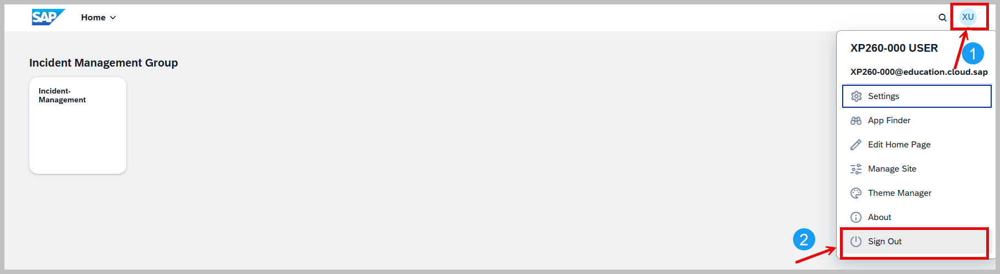

# Getting Started

## Table of Contents

- [Overview](#overview)
  - [Business Scenario](#business-scenario)
  - [Solution Diagram](#solution-diagram)
- [Access Your SAP BTP Subaccount](#access-your-sap-btp-subaccount)
  - [Review the Subscribed Services and Instances](#review-the-subscribed-services-and-instances)
    - [Subscriptions](#subscriptions)
    - [Instances](#instances)
    - [Environments](#environments)
  - [Review the Configured User Access](#review-the-configured-user-access)
- [Review the Development Environment](#review-the-development-environment)
- [Launch SAP Business Application Studio](#launch-sap-business-application-studio)
- [Login to Your Cloud Foundry Environment from SAP Business Application Studio](#login-to-your-cloud-foundry-environment-from-sap-business-application-studio)
  - [Login Using the User Interface (UI)](#1-login-using-the-user-interface-ui)
  - [Login Using the Command Line (Terminal)](#2-login-using-the-command-line-terminal)
- [Launch SAP Build Work Zone](#launch-sap-build-work-zone)
- [Verify the AI Security Assistant Environment](#verify-the-ai-security-assistant-environment)
- [Review Pre-Generated AI Security Scan Results](#review-pre-generated-ai-security-scan-results)
- [Summary](#summary)
  
## Overview 

In these hands-on exercises, we will be using the Incident Management Application, which is designed as a reference application for the [SAP BTP Developer's Guide](https://help.sap.com/docs/btp/btp-developers-guide/btp-developers-guide). It showcases best practices for developing applications on SAP Business AI Platform (SAP BAIP).

In addition to the manual security exercises, this workshop introduces an AI-powered OWASP security scanner built as a Claude Code plugin. The scanner automates vulnerability discovery against the OWASP Top 10 (2025) framework, demonstrating how AI can accelerate security reviews in real-world development workflows.

- ⚠️ **Note:** To keep this page open, right-click each link and choose **"Open link in new tab"**.

### Business Scenario
ACME, a leading electronics company, uses this application to manage customer service incidents. The application supports the following business process:
  1. A customer contacts ACME's call center with an issue.
  2. A call center representative (processor) receives the call.
  3. The representative creates a new incident in the system based on the customer's complaint.
  4. The conversation details are recorded as part of the incident.

### Solution Diagram
The solution diagram illustrates the key components and their interactions within the Incident Management Application deployed on SAP Business Technology Platform (SAP BTP).

  <p align="center">
    
    <br>
    <b></b>
  </p>

## Access your SAP BTP Subaccount
- Access your SAP BTP account for the session xp261 using this link: [Global Account: SAP-TechEd-2025 – Account Explorer](https://emea.cockpit.btp.cloud.sap/cockpit?idp=akihlqzx8.accounts.ondemand.com#/globalaccount/4c772782-0751-42ee-93c3-897452fdcb63/accountModel&//?section=HierarchySection&view=TreeTableView).

- ⚠️ **Note:** You will use an SAP BTP subaccount with subaccount admin privileges. We use the Identity Authentication service tenant **akihlqzx8.accounts.ondemand.com** as custom identity provider, both for platform and application users.

- Login to open your subaccount **xp261_0XX**, where **XX** is your seat number: 
  - Username: **xp261-0XX@education.cloud.sap** ( with XX depending on your seat from 01 - 40 )
  - Password: Will be given to you as part of the session.
  - In the list of directories and subaccounts, click on the entry for your subaccount.

### Review the Subscribed Services and Instances 

#### Subscriptions

| Application                           | Plan             |
| :------------------------------       | :--------------- |
| [Audit Log Viewer Service](https://discovery-center.cloud.sap/serviceCatalog/audit-log-service/?region=all)              | free             |
| [SAP Business Application Studio](https://discovery-center.cloud.sap/serviceCatalog/business-application-studio/?region=all)       | standard-edition |
| [SAP Build Work Zone, standard edition](https://discovery-center.cloud.sap/serviceCatalog/sap-build-work-zone-standard-edition/?region=all) | standard         |

#### Instances

| Instance Name                       | Service                                    | Plan        |
| :------------------------------     | :-------------------------------------     | :---------- |
| incident-management-auth            | [Authorization and Trust Management Service](https://discovery-center.cloud.sap/serviceCatalog/authorization-and-trust-management-service/?region=all) | application |
| incident-management-db              | [SAP HANA Schemas & HDI Containers](https://help.sap.com/docs/hana-cloud-database/sap-hana-cloud-sap-hana-database-deployment-infrastructure-hdi-reference/sap-hdi-containers)          | hdi-shared  |
| incident-management-destination     | [Destination Service](https://discovery-center.cloud.sap/serviceCatalog/destination-service/?service_plan=lite&region=all&commercialModel=btpea)                        | lite        |
| incident-management-html5-repo-host | [HTML5 Application Repository Service](https://help.sap.com/docs/btp/sap-business-technology-platform/html5-application-repository)       | app-host    |
| incident-management-html5-runtime   | [HTML5 Application Repository Service](https://help.sap.com/docs/btp/sap-business-technology-platform/html5-application-repository)       | app-runtime |

#### Environments

| Environment Name    | Plan       |
| :------------------ | :-------   |
| [Cloud Foundry Runtime](https://discovery-center.cloud.sap/protected/index.html#/serviceCatalog/cloud-foundry-runtime?region=all) | standard |

- Check the subscriptions, instances, and the environment under subaccount **xp261_0xx > Instances and Subscriptions** in the **SAP BTP cockpit**.
 
  <p align="center">
    
    <br>
    <b></b>
  </p>

### Review the Configured User Access:

- ⚠️ **Note:** In this workshop, your account **xp261-0xx@education.cloud.sap** fulfills two key roles: as a **platform administrator** for configuring role collections and infrastructure, and as a **business application user** for developing and testing secure Incident Management features. This duality simplifies the training environment by eliminating constant re-logins during exercises, but in real-world systems, strict role separation ensuring users hold only necessary permissions—is essential.

1- Check the users under **Security > Users**.

2- Check your user **xp261-0XX@education.cloud.sap**. There will be two representations in the cockpit, one as **platform user** and one as **business user**. 

3- Check **Role Collections** for the Business User
  - Locate and click on the business user representation in the user management interface.
  - Open the Role Collection Details in the right frame.
  - Confirm the Following Role Collections Are Assigned :
      - **BAS_Administrator**
      - **BAS Developer**
      - **Launchpad_Admin**
      - **XP261**

  <p align="center">
    
    <br>
    <b></b>
  </p>

4- To demonstrate real-world access control, you'll test the application using dedicated accounts with **precisely scoped** role collections. Unlike your **xp261-0xx@education.cloud.sap** training account's broad privileges, these users showcase how proper role assignments enforce **least privilege** in production:
  - **bob.smith@bestrun.com** (Support user)
  - **alice.jones@bestrun.com** (Support user)
  - **david.miller@bestrun.com** (Admin user)
  - Check the user role collections in the SAP BTP cockpit for **Bob, Alice, and David**
  - Select a user. In the right frame, check the role collections assigned:
      - Check if **bob.smith@bestrun.com** and **alice.jones@bestrun.com** are assigned to the role collection **Incident Management Support**. 
      - Check if **david.miller@bestrun.com** is assigned to the role collection **Incident Management Admin**.

 <p align="center">
    
    <br>
    <b></b>
  </p>

## Review the Development Environment
 
1- As we are using Cloud Foundry, check under **Cloud Foundry > Org Members**, if your platform user **xp261-0XX@education.cloud.sap** has **Org Manager, Org User** under **Org Roles**. 

 <p align="center">
    
    <br>
    <b></b>
  </p>

2- Under **Cloud Foundry > Spaces**, verify the existence of your space called **'xp261-0XX'**.
  
 <p align="center">
    
    <br>
    <b></b>
  </p>

3- Under Space **xp261-0XX > Space Members**, verify if your platform user **xp261-0XX@education.cloud.sap** has **Space Developer, Space Manager** under **Space Roles**.

 <p align="center">
    
    <br>
    <b></b>
  </p>

## Launch SAP Business Application Studio

Now after these checks, you can open the SAP Business Application Studio. 

1- Navigate to **Services > Instances and Subscriptions** in the **SAP BTP cockpit**. Then click on the small **Go to Application** icon next to the name SAP Business Application Studio.

 <p align="center">
    
    <br>
    <b></b>
  </p>

2- On the logon screen, click on the custom identity provider (IDP) **akihlqzx8.accounts.ondemand.com** to login with single sign-on (SSO). 
- ⚠️ **Note:**
    - If prompted for an **Origin Key**, enter: **akihlqzx8-platform**.
    - Always select the Custom Identity Provider **akihlqzx8.accounts.ondemand.com** when authenticating during exercises.
 <p align="center">
    
    <br>
    <b></b>
  </p>

3- Enter email and password in the login window.
- ⚠️ **Note:** You may not see this step if you're already authenticated through SSO.

 <p align="center">
    
    <br>
    <b></b>
  </p>

4- You will see your Dev Space called 'secure_incident_management'. Make sure it is in a **RUNNING** state, if not start it.

 <p align="center">
    
    <br>
    <b></b>
  </p>
  
5- When it is running, click on **secure_incident_management** to open the SAP Business Application Studio with your incident management application.

 <p align="center">
  
  <br>
  <b></b>
</p>

6- Click on **incident-management** to open the application in your workspace.

 <p align="center">
  
  <br>
  <b></b>
</p>

- In the workspace on the right side, you will find your incident management application in the list of projects.
 <p align="center">
  
  <br>
  <b></b>
</p>

7- **Bookmark your SAP Business Application Studio link**.

## Login to Your Cloud Foundry Environment from SAP Business Application Studio
Once you have SAP Business Application Studio open with your secure incident management project, you need to authenticate with your Cloud Foundry environment to deploy and manage applications. Choose one of the following methods to log in:

### 1. Login Using the User Interface (UI)

1. In SAP Business Application Studio, open the **Command Palette** (press **Ctrl+Shift+P** or select **View > Command Palette**) from the top menu.

<p align="center">
  
  <br>
  <b></b>
</p>
  
2. Search for and select **CF: Login to Cloud Foundry**.

<p align="center">
  
  <br>
  <b></b>
</p>

3. You’ll see **Cloud Foundry Sign In and Targets**. Select **SSO Passcode** and click on the link **Open New Browser** to generate your SSO Passcode.
<p align="center">
  
  <br>
  <b></b>
</p>

4. Select **Sign in** with your user **xp261-0XX@education.cloud.sap (origin: akihlqzx8-platform)**.
- ⚠️ **Note:** If your account is not displayed, click **Sign in to another account**.

<p align="center">
  
  <br>
  <b></b>
</p>

5. You’ll see a passcode page, copy the temporary authentication code generated in the **Passcode** field.
<p align="center">
  
  <br>
  <b></b>
</p>

6. Paste the **SSO Passcode** back into the SAP Business Application Studio and click on the **Sign In** button.
<p align="center">
  
  <br>
  <b></b>
</p>

7. In section **Cloud Foundry Target**, select **Organization** and **Space** (for example, `xp261-0XX`), then click on the **Apply** button.
<p align="center">
  
  <br>
  <b></b>
</p>

8. Once connected, a notification message pops up in the status bar in the SAP Business Application Studio confirming that your Cloud Foundry organization and space have been set and are ready for use.

<p align="center">
  
  <br>
  <b></b>
</p>
  
### 2. Login Using the Command Line (Terminal)

1. **Open Terminal**
   - In the SAP Business Application Studio, go to **Terminal > New Terminal** from the top menu.
   - A terminal window will open at the bottom of your workspace in your project directory **secure-incident-management**.

<p align="center">
  
  <br>
  <b></b>
</p>
   
2. **Run the following command to log in:**
  ```
  cf login -a https://api.cf.eu10-004.hana.ondemand.com  --origin akihlqzx8-platform
  ```
3. When prompted enter:
    * Email: xp261-0XX@education.cloud.sap
    * Password: Use the password provided during the session.
    
4.  To verify the login, run
  ```
    cf target
  ```
5- You should see the current organization and space listed.
  
<p align="center">
  
  <br>
  <b></b>
</p>

## Launch SAP Build Work Zone

1- Go back to **Services > Instances and Subscriptions** in the **SAP BTP cockpit**. Click on the **Go to Application** icon next to the **SAP Build Work Zone, standard edition** subscription to open the SAP Build Work Zone Site. 

<p align="center">
  
  <br>
  <b></b>
</p>

2- Check if the **Incident Management** Site is present. Click on the **Go to site** icon. 

<p align="center">
  
  <br>
  <b></b>
</p>

3- When the **Incident Management tile** is displayed, **Sign Out** from your current user **xp261-0xx@education.cloud.sap** and login to the application with the **alice.jones@bestrun.com** user. 

<p align="center">
  
  <br>
  <b></b>
</p>

4- Click on the tile to open the incident management application and **bookmark the URL**. 

<p align="center">
  
  <br>
  <b></b>
</p>


## Verify the AI Security Assistant Environment

All AI tooling — Claude Code CLI, the LiteLLM proxy, and the OWASP Scanner plugin — are **pre-installed** in your BAS Dev Space. The following steps verify that every component is operational before proceeding to the exercises.

### Step 1 — Verify Pre-installed Components

Open the integrated terminal in BAS and run the following verification commands:

1. **Verify Claude Code CLI:**

```bash
claude --version
```

**Expected result:** A version string such as `2.1.278 (Claude Code)`. Any version 2.x or higher confirms the CLI is installed.

2. **Verify LiteLLM proxy:**

```bash
ls ~/projects/workshop-xp261/litellm-proxy-ai-core/.venv/bin/litellm
```

**Expected result:** The file path is listed without errors. This confirms the Python virtual environment and LiteLLM binary are present.

3. **Verify the OWASP Scanner plugin:**

```bash
ls ls ~/projects/workshop-xp261/owasp-scan/skills/SKILL.md
```

**Expected result:** The file path is listed. This confirms the scanner plugin and its agent files, reference material, and templates are in place.

4. **Verify the environment configuration:**

```bash
cat ~/projects/workshop-xp261/litellm-proxy-ai-core/.env
```

**Expected result:** The file contains three `export` statements for `LITELLM_MASTER_KEY`, `AICORE_RESOURCE_GROUP`, and `AICORE_SERVICE_KEY`. These variables connect the proxy to SAP AI Core.

> If any of the above checks fail, notify your session instructor before continuing.

### Step 2 — Start the LiteLLM Proxy Server

Open a **new terminal** (Terminal 1) and start the local proxy:

```bash
cd ~/projects/workshop-xp261
./start-litellm.sh
```

The script will prompt for Cloud Foundry SSO authentication if needed, then start the proxy. Wait until you see:

```
LiteLLM: Proxy initialized with Config, Set models:
    claude-sonnet-5
INFO:     Application startup complete.
INFO:     Uvicorn running on http://0.0.0.0:4000 (Press CTRL+C to quit)
```

**Expected result:** The proxy starts without errors and displays the `Uvicorn running` message. Note the port number displayed — the Claude Code launch script detects it automatically.

Keep this terminal running. Do not close it.

### Step 3 — Launch Claude Code and Verify Connectivity

Open a **new terminal tab** (Terminal 2) and start Claude Code:

```bash
cd ~/projects/workshop-xp261
./start-claude.sh
```

The script automatically sources the environment configuration, detects the LiteLLM proxy port, and launches Claude Code. On **first launch only**, Claude Code presents four one-time prompts:

#### Step 3.1 — Confirm API Key

Claude Code detects the LiteLLM master key from the environment and asks for confirmation.

```
Do you want to use this API KEY?
ANTHROPIC_API_KEY: sk-4063...ffe412

[Y/n]: Y
```

**Action:** Press **Enter** to confirm (default is Y).

#### Step 3.2 — Terminal Settings

```
For the optimal coding experience, enable the recommended settings
for your terminal: Shift+Enter for newlines

  > 1. Yes, use recommended settings
    2. No, maybe later with /terminal-setup

Enter to confirm
```

**Action:** Select **1. Yes, use recommended settings** and press **Enter**.

#### Step 3.3 — Trust the Workspace

```
Accessing workspace:

  /home/user/projects/workshop-xp261

  Quick safety check: Is this a project you created or one you trust?
  Claude Code will be able to read, edit, and execute files here.

    No, exit
  > Yes, I trust this folder
```

**Action:** Select **Yes, I trust this folder** and press **Enter**.

#### Step 3.4 — Bypass Permissions Warning

Because the script uses `--dangerously-skip-permissions`, Claude Code displays a safety warning. This mode is intentional for the workshop sandbox environment.

```
WARNING: Claude Code running in Bypass Permissions mode

  Claude Code will not ask for your approval before running potentially
  dangerous commands. This mode should only be used in a sandboxed
  environment that can easily be restored if damaged.

    No, exit
  > Yes, I accept
```

**Action:** Select **Yes, I accept** and press **Enter**.

> These four prompts appear **one time only**. Subsequent launches skip directly to the Claude Code prompt.

#### Step 3.5 — Verify End-to-End Connectivity

In the Claude Code prompt, type:

```
Hello
```

**Expected result:** Claude Code responds with a greeting. This confirms the full chain is operational: Claude Code CLI → LiteLLM proxy → SAP AI Core → LLM response.

If you receive an error such as `API Error: 400` or `Connection refused`, verify that Terminal 1 (LiteLLM) is still running and retry.

### Terminal Layout Verification

At this point you should have three terminals open:

| Terminal | Purpose | How to verify |
|----------|---------|---------------|
| Terminal 0 | Primary shell (setup, builds) | Prompt shows `user: workshop-xp261 $` |
| Terminal 1 | LiteLLM proxy | Displays `Uvicorn running on http://0.0.0.0:4000` |
| Terminal 2 | Claude Code | Displays the Claude Code prompt (`>`) and responded to "Hello" |

**Expected result:** All three terminals are active. Terminal 1 shows continuous proxy logs. Terminal 2 shows the Claude Code interface ready for input.

---
## Review Pre-Generated AI Security Scan Results

Before the workshop, an AI-powered security scan was executed against the vulnerable `secure_incident_management` codebase using the OWASP Scanner plugin for Claude Code. The scan results are **pre-populated** in your workspace to save session time and ensure consistent findings across all participants.

> **Why pre-generated?** A live AI scan takes 5-8 minutes and produces variable results depending on LLM response timing. Pre-generating the report ensures every participant starts from the same baseline and can immediately focus on understanding the findings rather than waiting for a scan to complete.

When the scan completed, Claude Code displayed the following summary in the terminal:

```
  OWASP Security Scan Complete

  Target: secure_incident_management (SAP CAP / BTP incident management app)
  Date: 2026-09-29
  Output: .owasp-scan/ directory — 10 files generated, all validated

  Final Results: 8 Findings

  The scan identified **8 security findings** across 8 OWASP Top 10 (2025) categories. Review the findings table below:

```

| # | Severity   | Finding | OWASP Category | Component |
|:-:|:---------|---------|---------------|-----------|
| 1 | 🔴 Critical | SQL Injection via raw string concatenation in `fetchCustomer` | **A05 Injection** | Backend (`srv/services.js`) |
| 2 | 🔴 Critical | Missing row-level access control on Incidents — any support user sees all records | **A01 Broken Access Control** | Backend (`srv/services.cds`) |
| 3 | 🔴 Critical | Hardcoded mock credentials and auth bypass (`password: "initial"` in `package.json`) | **A07 Authentication Failures**, **A02 Security Misconfiguration** | Configuration (`package.json`) |
| 4 | 🟠 High   | Pre-built `.mtar` binary artifacts committed to the repository | **A03 Supply Chain Failures** | Repository (`mta_archives/`) |
| 5 | 🔴 Critical | PII and credit card data stored and served without encryption | **A04 Cryptographic Failures** | Database (`db/schema.cds`) |
| 6 | 🟡 Medium   | No structured security logging or alerting — zero audit trail | **A09 Logging & Alerting Failures** | Backend (`srv/services.js`) |
| 7 | 🟡 Medium   | Dev sandbox CDN scripts loaded without Subresource Integrity (SRI) | **A08 Data Integrity Failures** | Frontend (`webapp/index.html`) |
| 8 | 🟡 Medium   | No rate limiting or brute-force protection on any endpoint | **A06 Insecure Design** | Backend (`srv/services.js`) |

**Severity Summary:** 4 Critical, 1 High, 3 Medium

> **Note:** The full report contains detailed evidence for each finding, including exact file paths, line numbers, code snippets, attack preconditions, and remediation recommendations. Take a few minutes to read through the detailed descriptions in the `.md` file.

```
 Top Priorities

  1. Fix the SQL injection immediately — srv/services.js fetchCustomer has two
     deliberately vulnerable code paths with a working exploit. Replace raw SQL
     with CAP's parameterized query API.
  2. Add row-level security — ProcessorService.Incidents exposes every incident
     to any support user. Add @restrict with a where clause.
  3. Remove hardcoded credentials — password: "initial" in package.json must be
     moved out of source control.
  4. Encrypt/mask creditCardNo — PCI-sensitive field stored and served as
     plain text.
```

The sections below walk through the generated report files in detail.

### Step 1 — Locate the Scan Results

In the BAS Explorer, expand the following path:

```
secure_incident_management/
  └── .owasp-scan/
        ├── 2026-09-29_secure_incident_management_FINDINGS.md
        ├── 2026-09-29_secure_incident_management_FINDINGS.json
        ├── 2026-09-29_secure_incident_management_FINDINGS_VALIDATED.json
        ├── 2026-09-29_secure_incident_management_FINDINGS_VALIDATION_REPORT.json
        ├── 2026-09-29_secure_incident_management_LANDSCAPE.json
        ├── 2026-09-29_secure_incident_management_LANDSCAPE.md
        ├── 2026-09-29_secure_incident_management_REVIEWED_FINDINGS.md          ← primary report
        ├── 2026-09-29_secure_incident_management_REVIEWED_FINDINGS.json
        ├── 2026-09-29_secure_incident_management_REVIEWED_FINDINGS_FINAL.json
        └── 2026-09-29_secure_incident_management_REVIEWED_FINDINGS_VALIDATED.json
```

**Expected result:** The `.owasp-scan` folder contains 10 files. If the folder is missing or empty, notify your session instructor.

### Step 2 — Open the Reviewed Findings Report

Click on **`2026-09-29_secure_incident_management_REVIEWED_FINDINGS.md`** to open the curated security report. This is the final output of the three-phase AI scan pipeline:

| Phase | Name | Purpose |
|-------|------|---------|
| Phase 1 | **Discovery** | Mapped the codebase architecture: components, data flows, trust boundaries, dependencies |
| Phase 2 | **Analysis** | Scanned the codebase against all 10 OWASP Top 10 (2025) categories with evidence-grounded findings |
| Phase 3 | **Review** | A senior-reviewer pass that verified every finding against the code, removed false positives, and curated the final report |

The review phase consolidated overlapping findings and validated each against the source code. The final report contains **8 confirmed findings** — all validated with code-level evidence.

### Step 3 — Identify the Exercise Targets

Three of the 8 findings map directly to the hands-on exercises you will complete next. These are the vulnerabilities you will learn to exploit and remediate:

| Finding | Severity | OWASP Category | Your Exercise |
|---------|----------|---------------|---------------|
| #2 — Missing row-level access control on Incidents | 🔴 Critical | **A01 Broken Access Control** | [Exercise 1](../ex1/README.md) |
| #1 — SQL Injection via raw string concatenation | 🔴 Critical | **A05 Injection** | [Exercise 2](../ex2/README.md) |
| #6 — No structured security logging or alerting | 🟡 Medium | **A09 Logging & Alerting Failures** | [Exercise 3](../ex3/README.md) |

The remaining 5 findings (hardcoded credentials and auth bypass, pre-built binary artifacts, plaintext PII/credit card data, missing SRI, no rate limiting) are real vulnerabilities documented in the report. They are not covered in the hands-on exercises but represent common security gaps in cloud applications that should be addressed in a production environment.

### How the Scan Was Generated (Reference)

For reference, the pre-populated scan was produced using the following command in the Claude Code terminal:

```
/owasp-analysis
```

This invokes the OWASP Scanner plugin at `owasp-scan/skills/`, which reads the `secure_incident_management` codebase and executes the three-phase pipeline. The command file is located at `.claude/commands/owasp-analysis.md`.

If you wish to **re-run the scan** at any point during the workshop (for example, after applying fixes), delete the existing results and run the command again:

```bash
rm -rf ~/projects/workshop-xp261/secure_incident_management/.owasp-scan/
```

Then in Claude Code:

```
/owasp-analysis
```

> **Note:** A live scan takes 10-20 minutes and consumes AI Core credits. The pre-generated results are sufficient for all exercises.

### Key Takeaway

The AI scanner identified every critical vulnerability in the application — including the three you will remediate in the following exercises — in a single automated pass. This demonstrates how AI-assisted security review can compress hours of manual code review into minutes. However, the findings still require human expertise to understand, prioritize, validate in context, and fix correctly. That is what the remaining exercises will teach you.

---


Now you are ready to start the exercises. 


## Summary

Now that you have made yourself familiar with the setup,
continue to - [Exercise 1 - Broken Access Control](../ex1/README.md)
