# Getting Started

## Table of Contents

- [Overview](#overview)
  - [Business Scenario](#business-scenario)
  - [Solution Diagram](#solution-diagram)
- [Access Your SAP BTP Subaccount](#access-your-sap-btp-subaccount)
  - [Review the Subscribed Services and Instances](#review-the-subscribed-services-and-instances)
    - [Subscriptions](#subscriptions)
    - [Instances](#instances)
    - [Environments](#environments)
  - [Review the Configured User Access](#review-the-configured-user-access)
- [Review the Development Environment](#review-the-development-environment)
- [Launch SAP Business Application Studio](#launch-sap-business-application-studio)
- [Login to Your Cloud Foundry Environment from SAP Business Application Studio](#login-to-your-cloud-foundry-environment-from-sap-business-application-studio)
  - [Login Using the User Interface (UI)](#1-login-using-the-user-interface-ui)
  - [Login Using the Command Line (Terminal)](#2-login-using-the-command-line-terminal)
- [Launch SAP Build Work Zone](#launch-sap-build-work-zone)
- [Review Pre-Generated AI Security Scan Results](#review-pre-generated-ai-security-scan-results)
- [Summary](#summary)
  
## Overview 

In these hands-on exercises, we will be using the Incident Management Application, which is designed as a reference application for the [SAP BTP Developer's Guide](https://help.sap.com/docs/btp/btp-developers-guide/btp-developers-guide). It showcases best practices for developing applications on SAP Business AI Platform (SAP BAIP).

In addition to the manual security exercises, this workshop introduces an AI-powered OWASP security scanner built as a Claude Code plugin. The scanner automates vulnerability discovery against the OWASP Top 10 (2025) framework, demonstrating how AI can accelerate security reviews in real-world development workflows.

- ⚠️ **Note:** To keep this page open, right-click each link and choose **"Open link in new tab"**.

### Business Scenario
ACME, a leading electronics company, uses this application to manage customer service incidents. The application supports the following business process:
  1. A customer contacts ACME's call center with an issue.
  2. A call center representative (processor) receives the call.
  3. The representative creates a new incident in the system based on the customer's complaint.
  4. The conversation details are recorded as part of the incident.

### Solution Diagram
The solution diagram illustrates the key components and their interactions within the Incident Management Application deployed on SAP Business Technology Platform (SAP BTP).

  <p align="center">
    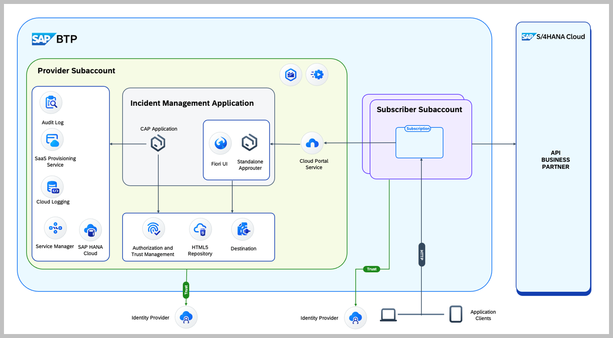
    <br>
    <b></b>
  </p>

## Access your SAP BTP Subaccount
- Access your SAP BTP account for the session xp261 using this link: [Global Account: SAP-TechEd-2026 – Account Explorer](https://emea.cockpit.btp.cloud.sap/cockpit/?idp=akihlqzx8.accounts.ondemand.com#/globalaccount/33a7ade5-6a9f-4ba4-a424-d111a7513f58/).

- ⚠️ **Note:** You will work in your own SAP BTP subaccount with read-only (Viewer) access at the subaccount level and Cloud Foundry Org User / Space Developer rights, which allow you to deploy and run the application. 
The Identity Authentication tenant **akihlqzx8.accounts.ondemand.com** is configured as the custom identity provider for both platform and application users.

- [Login to open your subaccount **xp261_0XX**](https://emea.cockpit.btp.cloud.sap/cockpit/?idp=akihlqzx8.accounts.ondemand.com#/globalaccount/33a7ade5-6a9f-4ba4-a424-d111a7513f58/), where **XX** is your seat number: 
  - Username: **xp261-0XX@education.cloud.sap** ( with XX depending on your seat from 01 - 40 )
  - Password: Will be given to you as part of the session.
  - In the list of directories and subaccounts, click on the entry for your subaccount.

### Review the Subscribed Services and Instances 

#### Subscriptions

| Application                           | Plan             |
| :------------------------------       | :--------------- |
| [Audit Log Viewer Service](https://discovery-center.cloud.sap/serviceCatalog/audit-log-service/?region=all)              | free             |
| [SAP Business Application Studio](https://discovery-center.cloud.sap/serviceCatalog/business-application-studio/?region=all)       | standard-edition |
| [SAP Build Work Zone, standard edition](https://discovery-center.cloud.sap/serviceCatalog/sap-build-work-zone-standard-edition/?region=all) | standard         |

#### Instances

| Instance Name                       | Service                                    | Plan        |
| :------------------------------     | :-------------------------------------     | :---------- |
| incident-management-auth            | [Authorization and Trust Management Service](https://discovery-center.cloud.sap/serviceCatalog/authorization-and-trust-management-service/?region=all) | application |
| incident-management-db              | [SAP HANA Schemas & HDI Containers](https://help.sap.com/docs/hana-cloud-database/sap-hana-cloud-sap-hana-database-deployment-infrastructure-hdi-reference/sap-hdi-containers)          | hdi-shared  |
| incident-management-destination     | [Destination Service](https://discovery-center.cloud.sap/serviceCatalog/destination-service/?service_plan=lite&region=all&commercialModel=btpea)                        | lite        |
| incident-management-html5-repo-host | [HTML5 Application Repository Service](https://help.sap.com/docs/btp/sap-business-technology-platform/html5-application-repository)       | app-host    |
| incident-management-html5-runtime   | [HTML5 Application Repository Service](https://help.sap.com/docs/btp/sap-business-technology-platform/html5-application-repository)       | app-runtime |

#### Environments

| Environment Name    | Plan       |
| :------------------ | :-------   |
| [Cloud Foundry Runtime](https://discovery-center.cloud.sap/protected/index.html#/serviceCatalog/cloud-foundry-runtime?region=all) | standard |

- Check the subscriptions, instances, and the environment under subaccount **xp261_0xx > Instances and Subscriptions** in the **SAP BTP cockpit**.
 
  <p align="center">
    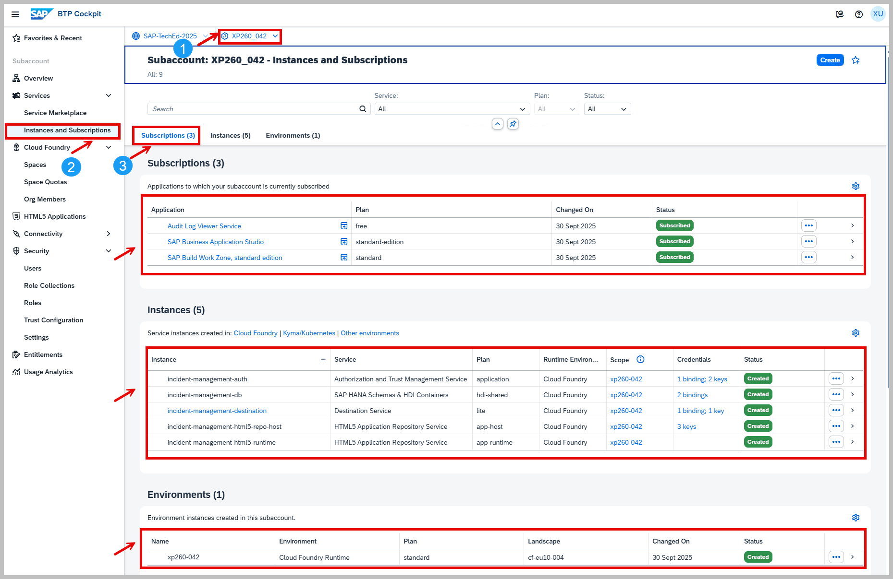
    <br>
    <b></b>
  </p>

### Review the Configured User Access:

- ⚠️ **Note:** In this workshop, your account **xp261-0xx@education.cloud.sap** fulfills two key roles: as a **platform user** with Subaccount Viewer access for monitoring platform resources, and as
 **application user** for developing and testing secure Incident Management features. This setup simplifies the training environment by eliminating constant re-logins during exercises. In real-world systems, however, strict role separation is essential — users should hold only the permissions required for their specific tasks.

#### Step 1 — Navigate to User Management

In the SAP BTP Cockpit, go to **Security → Users**.

---

#### Step 2 — Locate Your User

Find your user: **`xp261-0XX@education.cloud.sap`**

> **Note:** Your user will appear **twice** in the cockpit — once as a **Platform User** and once as an **Application User**. Each representation has a different set of role collections and serves a distinct purpose.

---

#### Step 3 — Verify Platform User Role Collection

Click on the **Platform User** representation and confirm the following role collection is assigned:

| Role Collection | Purpose |
|---|---|
| `Subaccount Viewer` | Grants read-only access to the subaccount |

---

#### Step 4 — Verify Application User Role Collections

1. Click on the **Application User** representation in the user management interface.
2. Open the **Role Collection Details** panel on the right.
3. Confirm that **all** of the following role collections are assigned:

| Role Collection | Purpose |
|---|---|
| `auditlog-viewer` | View audit logs via the SAP Audit Log Viewer service |
| `Business_Application_Studio_Administrator` | Manage BAS user data and dev spaces |
| `Business_Application_Studio_Developer` | Develop and build applications in BAS |
| `Business_Application_Studio_Extension_Deployer` | Deploy custom extensions |
| `Launchpad_Admin` | Manage SAP Build Work Zone / Launchpad |

> **Important:** If any role collections are missing, contact your instructor to have them assigned before proceeding.
          
  <p align="center">
    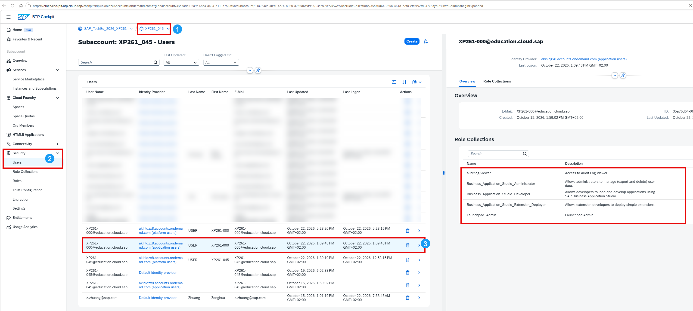
    <br>
    <b></b>
  </p>

4- To demonstrate real-world access control, you'll test the application using dedicated accounts with **precisely scoped** role collections. Unlike your **xp261-0xx@education.cloud.sap** training account's broad privileges, these users showcase how proper role assignments enforce **least privilege** in production:
  - **bob.smith@bestrun.com** (Support user)
  - **alice.jones@bestrun.com** (Support user)
  - **david.miller@bestrun.com** (Admin user)
  - Check the user role collections in the SAP BTP cockpit for **Bob, Alice, and David**
  - Select a user. In the right frame, check the role collections assigned:
      - Check if **bob.smith@bestrun.com** and **alice.jones@bestrun.com** are assigned to the role collection **Incident Management Support**. 
      - Check if **david.miller@bestrun.com** is assigned to the role collection **Incident Management Admin**.

 <p align="center">
    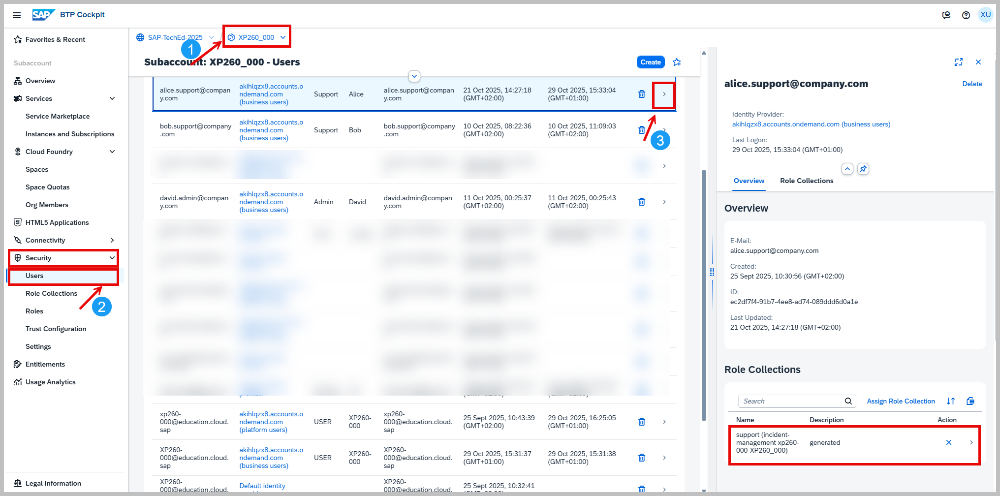
    <br>
    <b></b>
  </p>

## Review the Development Environment
 
1- As we are using Cloud Foundry, check under **Cloud Foundry > Org Members**, if your platform user **xp261-0XX@education.cloud.sap** has **Org User** under **Org Roles**. 

 <p align="center">
    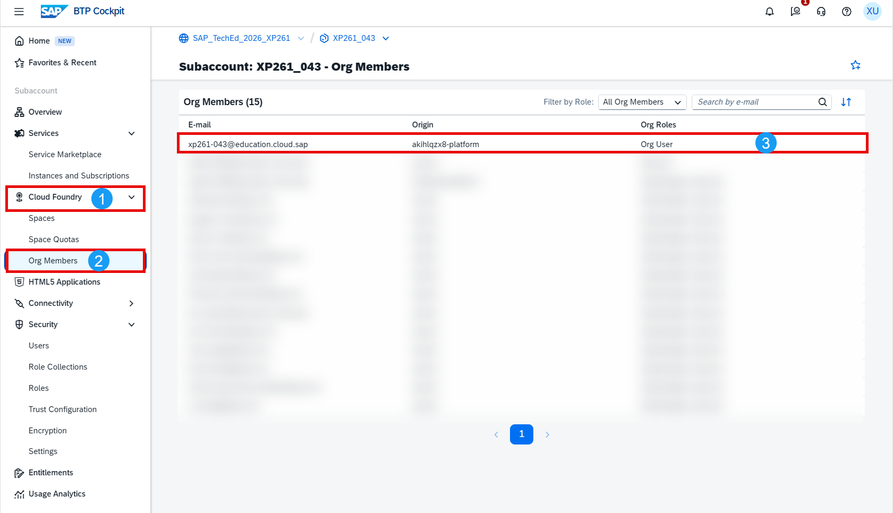
    <br>
    <b></b>
  </p>

2- Under **Cloud Foundry > Spaces**, verify the existence of your space called **'xp261-0XX'**.
  
 <p align="center">
    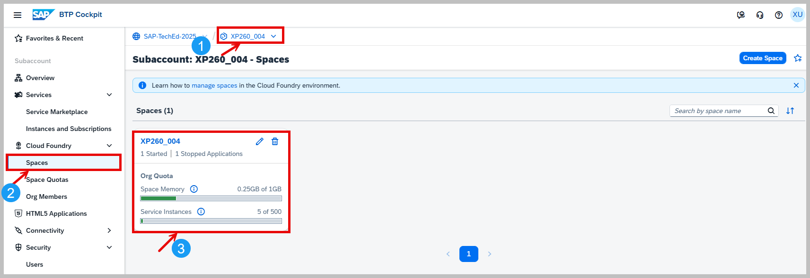
    <br>
    <b></b>
  </p>

3- Under Space **xp261-0XX > Space Members**, verify if your platform user **xp261-0XX@education.cloud.sap** has **Space Developer, Space Auditor** under **Space Roles**.

 <p align="center">
    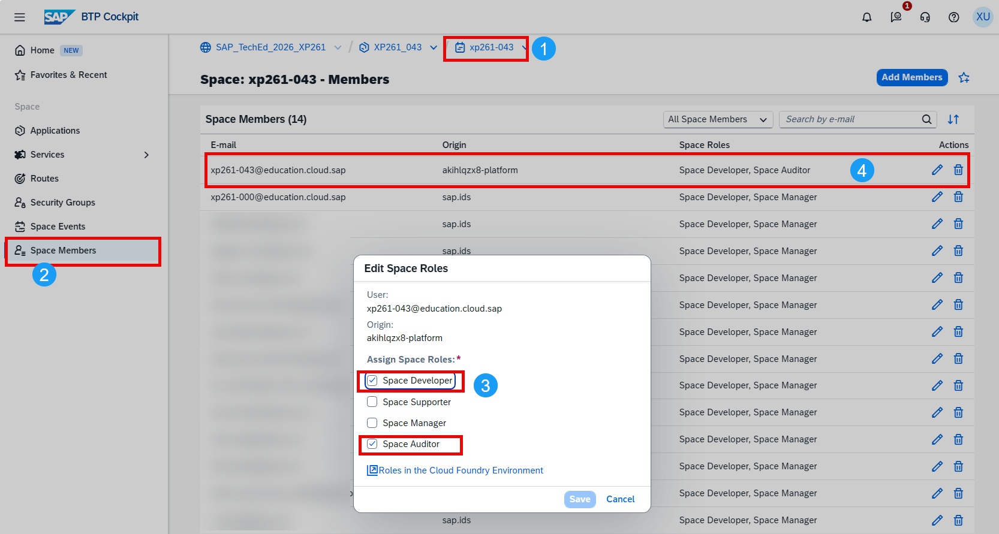
    <br>
    <b></b>
  </p>

## Launch SAP Business Application Studio

Now after these checks, you can open the SAP Business Application Studio. 

1- Navigate to **Services > Instances and Subscriptions** in the **SAP BTP cockpit**. Then click on the small **Go to Application** icon next to the name SAP Business Application Studio.

 <p align="center">
    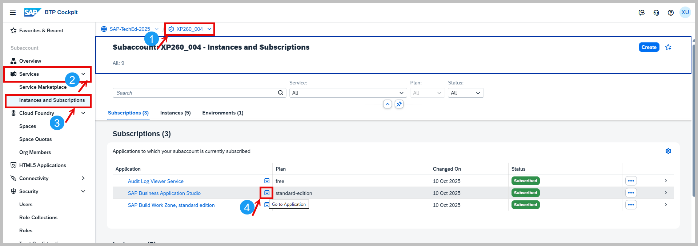
    <br>
    <b></b>
  </p>

2- On the logon screen, click on the custom identity provider (IDP) **akihlqzx8.accounts.ondemand.com** to login with single sign-on (SSO). 
- ⚠️ **Note:**
    - If prompted for an **Origin Key**, enter: **akihlqzx8-platform**.
    - Always select the Custom Identity Provider **akihlqzx8.accounts.ondemand.com** when authenticating during exercises.
 <p align="center">
    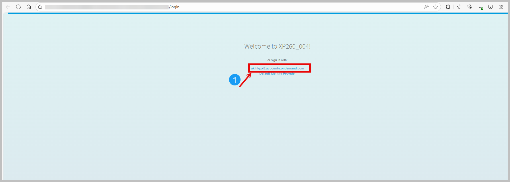
    <br>
    <b></b>
  </p>

3- Enter email and password in the login window.
- ⚠️ **Note:** You may not see this step if you're already authenticated through SSO.

 <p align="center">
    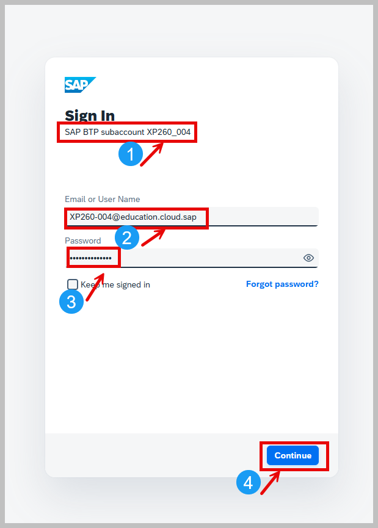
    <br>
    <b></b>
  </p>

4- You will see your Dev Space called 'secure_incident_management'. Make sure it is in a **RUNNING** state, if not start it.

 <p align="center">
    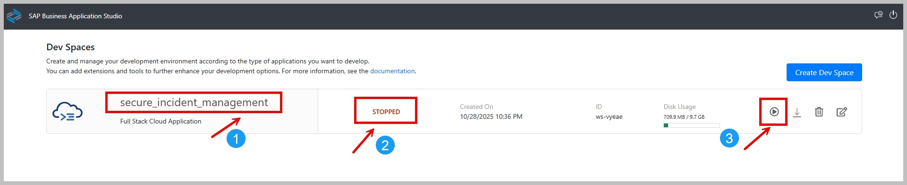
    <br>
    <b></b>
  </p>
  
5- When it is running, click on **secure_incident_management** to open the SAP Business Application Studio with your incident management application.

 <p align="center">
  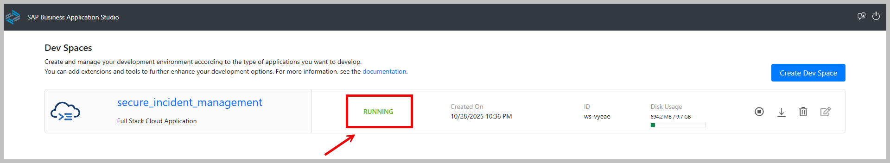
  <br>
  <b></b>
</p>

6- Open the Project in SAP Business Application Studio

  - **Click the Explorer icon** in the left activity bar to open the Explorer panel.
  - **Click the Open Folder button** — this opens a folder selection dialog at the top of the screen.
  - **Enter the following path** in the folder input field: **/home/user/projects/workshop-xp261/**
  - **Click OK** to confirm and open the project in your workspace.

 <p align="center">
  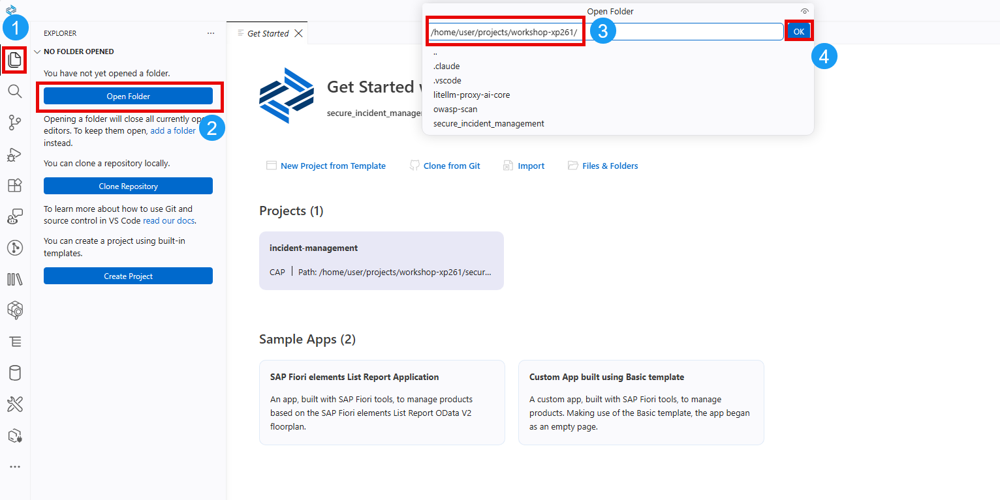
  <br>
  <b></b>
</p>

- In the explorer on the right side, you will find your `incident management application` in the list of projects.
 <p align="center">
  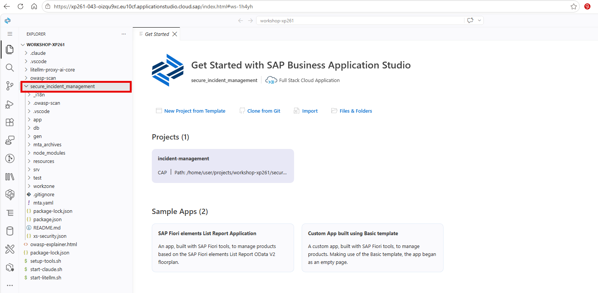
  <br>
  <b></b>
</p>

7- **Bookmark your SAP Business Application Studio link**.

## Login to Your Cloud Foundry Environment from SAP Business Application Studio
Once you have SAP Business Application Studio open with your secure incident management project, you need to authenticate with your Cloud Foundry environment to deploy and manage applications. Choose one of the following methods to log in:

### 1. Login Using the User Interface (UI)

1. In SAP Business Application Studio, open the **Command Palette** (press **Ctrl+Shift+P** or select **View > Command Palette**) from the top menu.

<p align="center">
  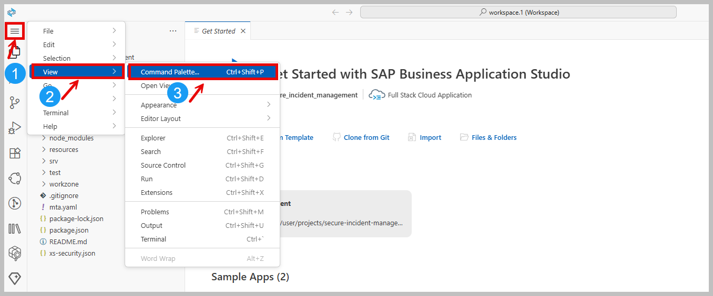
  <br>
  <b></b>
</p>
  
2. Search for and select **CF: Login to Cloud Foundry**.

<p align="center">
  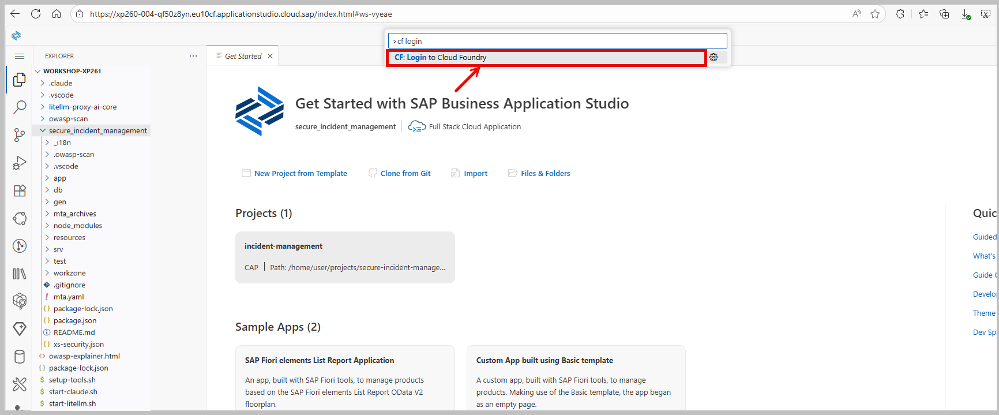
  <br>
  <b></b>
</p>

3. You’ll see **Cloud Foundry Sign In and Targets**. Select **SSO Passcode** and click on the link **Open New Browser** to generate your SSO Passcode.
<p align="center">
  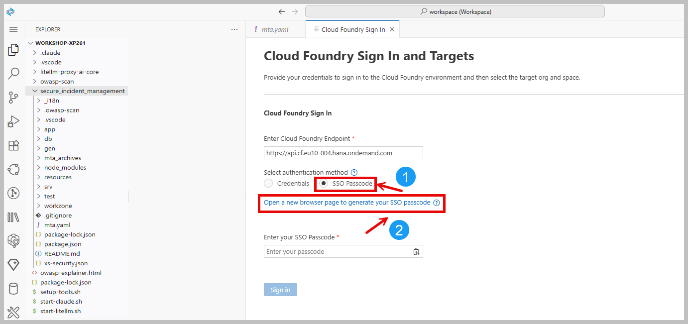
  <br>
  <b></b>
</p>

4. Select **Sign in** with your user **xp261-0XX@education.cloud.sap (origin: akihlqzx8-platform)**.
- ⚠️ **Note:** If your account is not displayed, click **Sign in to another account**.

<p align="center">
  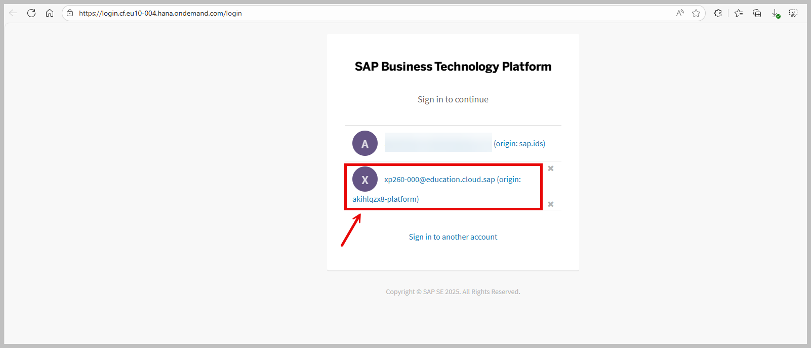
  <br>
  <b></b>
</p>

5. You’ll see a passcode page, copy the temporary authentication code generated in the **Passcode** field.
<p align="center">
  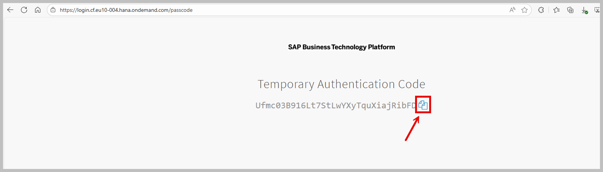
  <br>
  <b></b>
</p>

6. Paste the **SSO Passcode** back into the SAP Business Application Studio and click on the **Sign In** button.
<p align="center">
  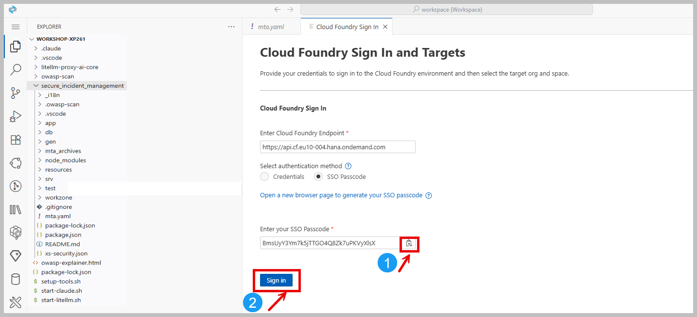
  <br>
  <b></b>
</p>

7. In section **Cloud Foundry Target**, select **Organization** and **Space** (for example, `xp261-0XX`), then click on the **Apply** button.
<p align="center">
  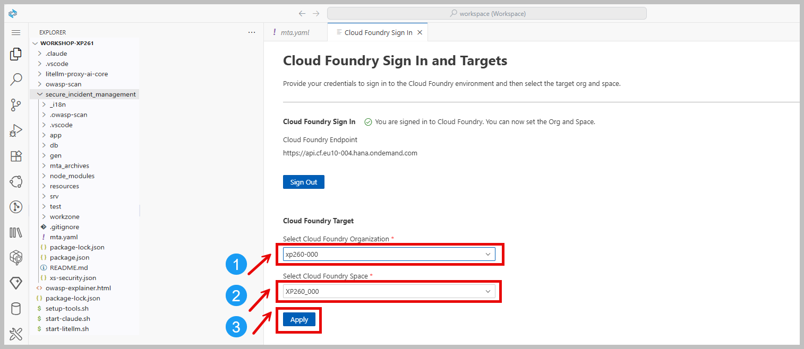
  <br>
  <b></b>
</p>

8. Once connected, a notification message pops up in the status bar in the SAP Business Application Studio confirming that your Cloud Foundry organization and space have been set and are ready for use.

<p align="center">
  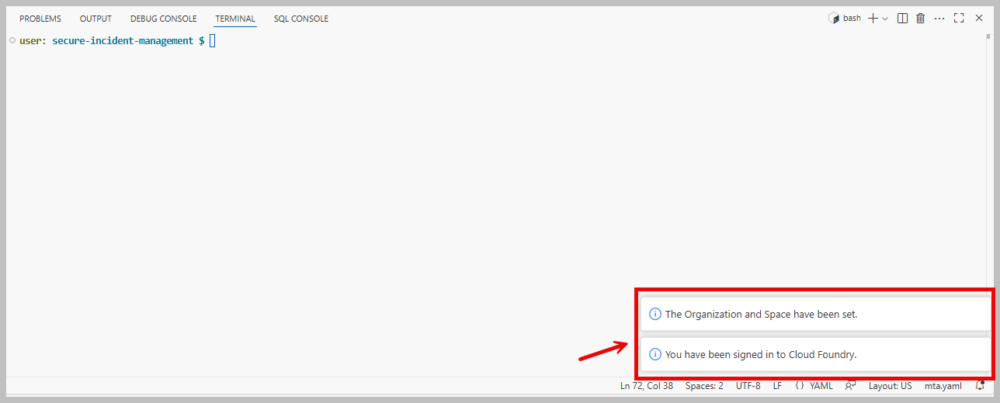
  <br>
  <b></b>
</p>

9. In the Explorer panel, right-click the **secure-incident-management** project and select **Open in Integrated Terminal**.
A terminal window opens at the bottom of your workspace, already pointing to the secure-incident-management directory.

⚠️ Important — Exercises 1.1 to 3.2: Always ensure your terminal is working from the secure-incident-management directory before running any command. If you open a new terminal or navigate away, run the following to return to the correct location:

````
cd secure-incident-management

````
  
### 2. Login Using the Command Line (Terminal)

1. **Open Terminal**
   - In the SAP Business Application Studio, go to **Terminal > New Terminal** from the top menu.
   - A terminal window will open at the bottom of your workspace in your project directory **secure-incident-management**.

<p align="center">
  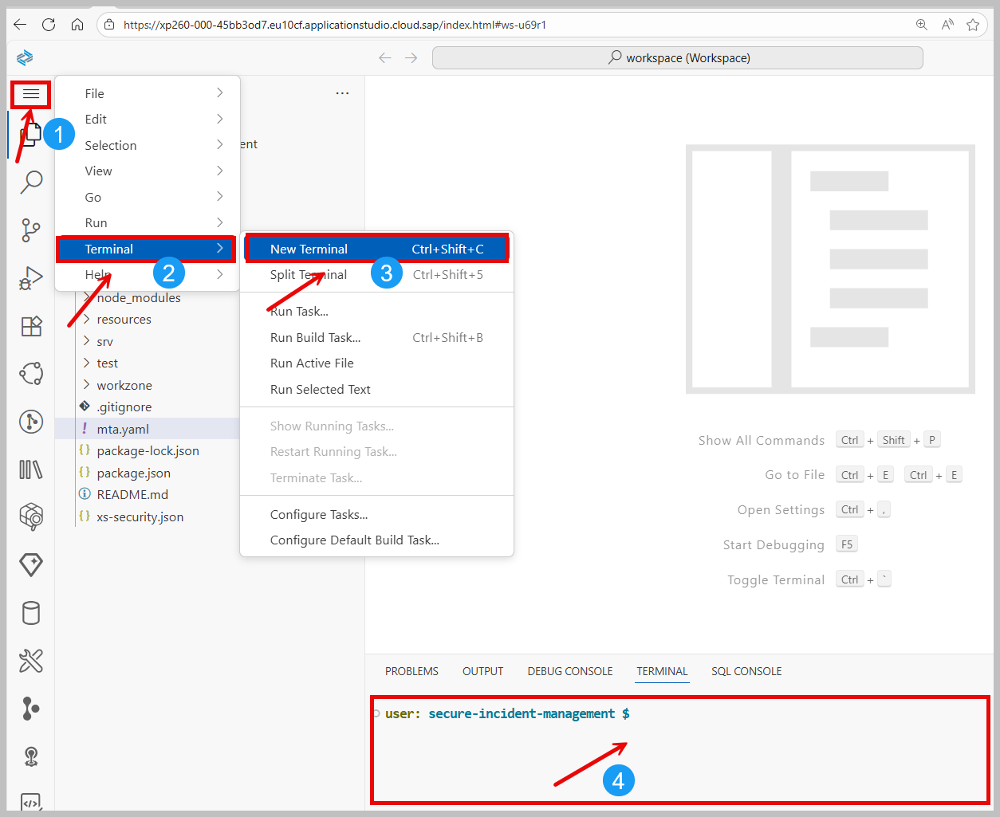
  <br>
  <b></b>
</p>
   
2. **Run the following command to log in:**
  ```
  cf login -a https://api.cf.eu10-005.hana.ondemand.com  --origin akihlqzx8-platform
  ```
3. When prompted enter:
    * Email: xp261-0XX@education.cloud.sap
    * Password: Use the password provided during the session.
    
4.  To verify the login, run
  ```
    cf target
  ```
5- You should see the current organization and space listed.
  
<p align="center">
  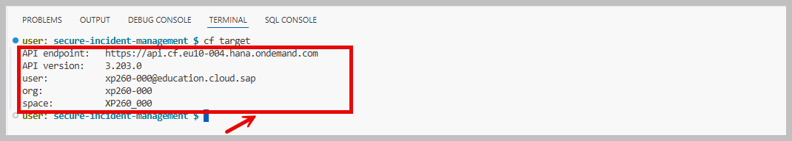
  <br>
  <b></b>
</p>

## Launch SAP Build Work Zone

### Check and Start the incident-management-srv Application

Before launching SAP Build Work Zone, verify that the backend application is running:

1. Navigate to your subaccount in the SAP BTP cockpit.

2. In the left navigation, go to **Cloud Foundry** > **Spaces**.

3. Select your space **XP261-0XX**.

4. In the **Applications** list, locate **incident-management-srv**.

5. Check the **Requested State** column:

   | State        | Meaning                                          | Action                                                                 |
   |:-------------|:-------------------------------------------------|:-----------------------------------------------------------------------|
   | 🟢 Started   | The application is active and ready.             | No action needed — proceed to the next step.                           |
   | 🔴 Stopped   | The application is not running.                  | Click the **Start** button under the **Actions** column to start it.   |

   > If you started the application, wait until the state changes to 🟢 **Started** before continuing.

### Open SAP Build Work Zone

1- Go back to **Services > Instances and Subscriptions** in the **SAP BTP cockpit**. Click on the **Go to Application** icon next to the **SAP Build Work Zone, standard edition** subscription to open the SAP Build Work Zone Site. 

<p align="center">
  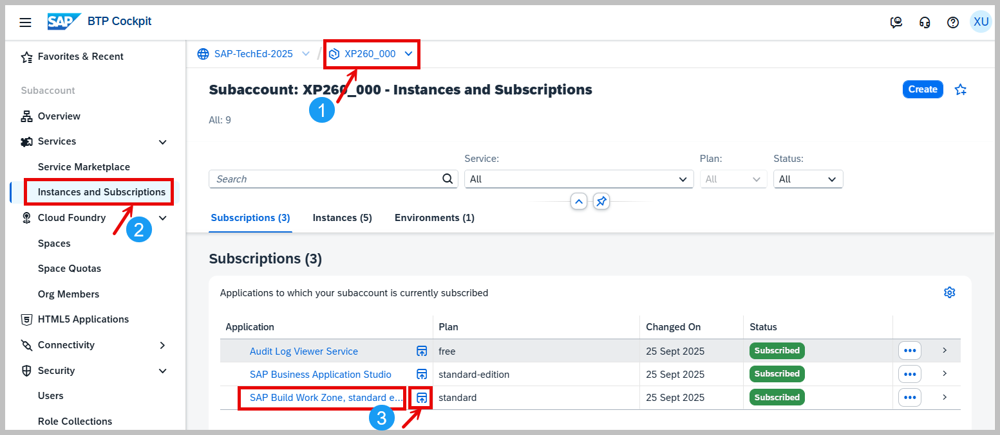
  <br>
  <b></b>
</p>

2-  Update Content - Optional - : Ensure SAP Build Work Zone has the latest content from your HTML5 application.
  1. In the left navigation menu, choose the **Channel Manager** icon.
  2. Choose **Update Content** to sync the latest application metadata.

<p align="center">
  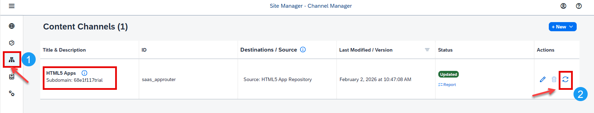
  <br>
  <b></b>
</p>

3- Check if the **Incident Management** Site is present. Click on the **Go to site** icon. 

<p align="center">
  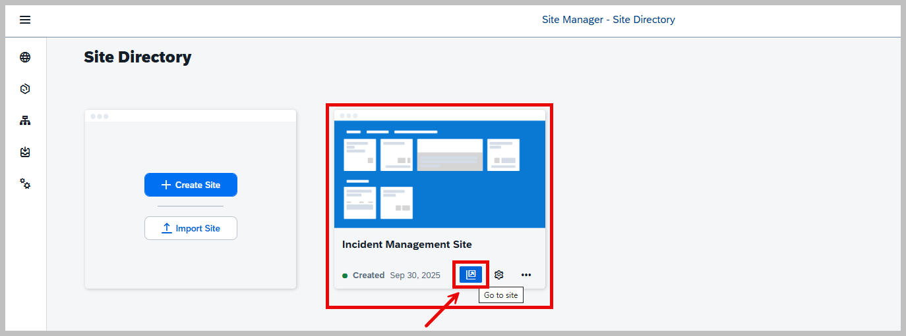
  <br>
  <b></b>
</p>

4- When the **Incident Management tile** is displayed :
  - Copy the application URL.
  - Open an **InPrivate / Incognito window** in your browser and paste the link.
  - Log in to the application using the business user **alice.jones@bestrun.com**.

<p align="center">
  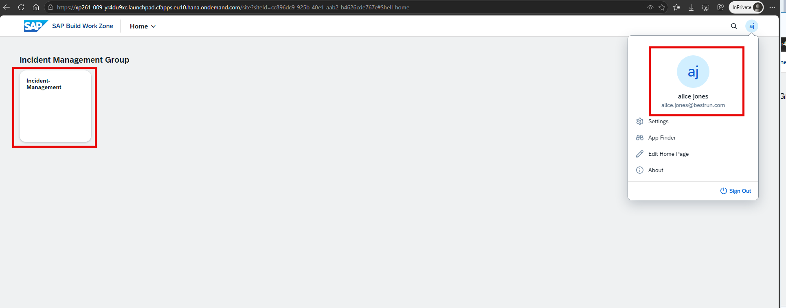
  <br>
  <b></b>
</p>

**Tip:** Using a private window allows you to run two active sessions at the same time and prevents you from being automatically logged out of your platform user (xp261-0xx@education.cloud.sap) in the SAP BTP Cockpit.

5- Click on the tile to open the incident management application and **bookmark the URL**. 

<p align="center">
  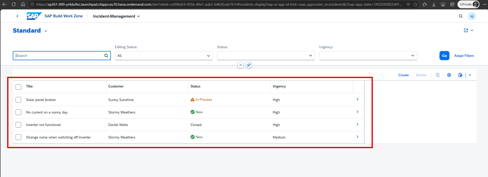
  <br>
  <b></b>
</p>

## Review Pre-Generated AI Security Scan Results

Before the workshop, **AI OWASP Scanner Assistant** was executed against the vulnerable `secure_incident_management` codebase using the OWASP Scanner plugin for Claude Code. The scan results are **pre-populated** in your workspace to save session time and ensure consistent findings across all participants.

> **Why pre-generated?** A live AI scan takes 10-15 minutes and produces variable results depending on LLM response timing. Pre-generating the report ensures every participant starts from the same baseline and can immediately focus on understanding the findings rather than waiting for a scan to complete.

When the scan completed, Claude Code displayed the following summary in the terminal:

```
  OWASP Security Scan Complete

  Target:  secure_incident_management (SAP CAP / BTP incident management app)
  Date:    2026-10-21
  Edition: OWASP Top 10:2025
  Stack:   SAP CAP · Node.js · HANA · XSUAA
  Output directory:.owasp-scan/`

  Final findings summary — 8 findings after review

```

# OWASP Security Findings

| # | Severity | Finding | OWASP Category | Component |
|---|----------|---------|----------------|-----------|
| 1 | 🔴 Critical | SQL Injection in `AdminService.fetchCustomer` — raw SQL string interpolation passed to `cds.run()` | **A05 Injection** | Backend (`srv/services.js`) |
| 2 | 🔴 Critical | Missing Row-Level Access Control on Incidents — no `@restrict where` (horizontal) + no DELETE handler (vertical) | **A01 Broken Access Control**, **A06 Insecure Design** | Backend (`srv/services.cds`) |
| 3 | 🔴 Critical | Hardcoded mocked credentials with admin role committed in `package.json` | **A07 Authentication Failures** | Configuration (`package.json`) |
| 4 | 🔴 Critical | Plaintext credit card PANs in seed data CSV, no `@PersonalData` annotation | **A04 Cryptographic Failures** | Database (`db/schema.cds`) |
| 5 | 🟡 Medium | No SCA tool configured; all deps use `^` ranges, no Dependabot/Snyk | **A03 Supply Chain Failures** | Configuration (`package.json`) |
| 6 | 🟡 Medium | External SAPUI5 CDN script loaded without Subresource Integrity | **A08 Data Integrity Failures** | Frontend (`webapp/index.html`) |
| 7 | 🟡 Medium | No security audit logging; `console.log`-only, no audit-log binding in `mta.yaml` | **A09 Logging & Alerting Failures** | Backend (`srv/services.js`) |
| 8 | ⚪ Low | Pre-built `.mtar` binary artifact committed to repository | **A03 Supply Chain Failures** | Repository (`mta_archives/`) |


**Severity Summary:** 4 Critical, 3 Medium, 1 low

The sections below walk through the generated report files .

### Step 1 — Locate the Scan Results

In the BAS Explorer, expand the following path:

```
secure_incident_management/
  └── .owasp-scan/
        | File | Purpose |
        |------|---------|
        ├──  `2026-10-21_secure_incident_management_FINDINGS.md` | Phase 1 analysis report (human-readable) |
        ├──  `2026-10-21_secure_incident_management_FINDINGS.json` | Phase 1 machine-readable findings |
        ├──  `2026-10-21_secure_incident_management_FINDINGS_VALIDATED.json` | Validated Phase 1 findings ✅ |
        ├──  `2026-10-21_secure_incident_management_VALIDATION_REPORT.json` | Phase 1 validation log |
        ├──  `2026-10-21_secure_incident_management_REVIEWED_FINDINGS.md` | Phase 2 reviewed report (primary report) |
        ├──  `2026-10-21_secure_incident_management_REVIEWED_FINDINGS.json` | Phase 2 machine-readable findings |
        ├──  `2026-10-21_secure_incident_management_REVIEWED_FINDINGS_VALIDATED.json` | Validated Phase 2 findings ✅ |
        ├──  `2026-10-21_secure_incident_management_REVIEWED_VALIDATION_REPORT.json` | Phase 2 validation log |
        └──  `2026-10-21_secure_incident_management_REPORT.html` | Interactive HTML dashboard |
```

**Expected result:** The `.owasp-scan` folder contains 9 files. If the folder is missing or empty, notify your session instructor.

### Step 2 — Open the Reviewed Security Report

Download and open the curated security report [**`2026-10-21_secure_incident_management_REPORT.html'**](./2026-10-21_secure_incident_management_REPORT.html). 


<p align="center">
  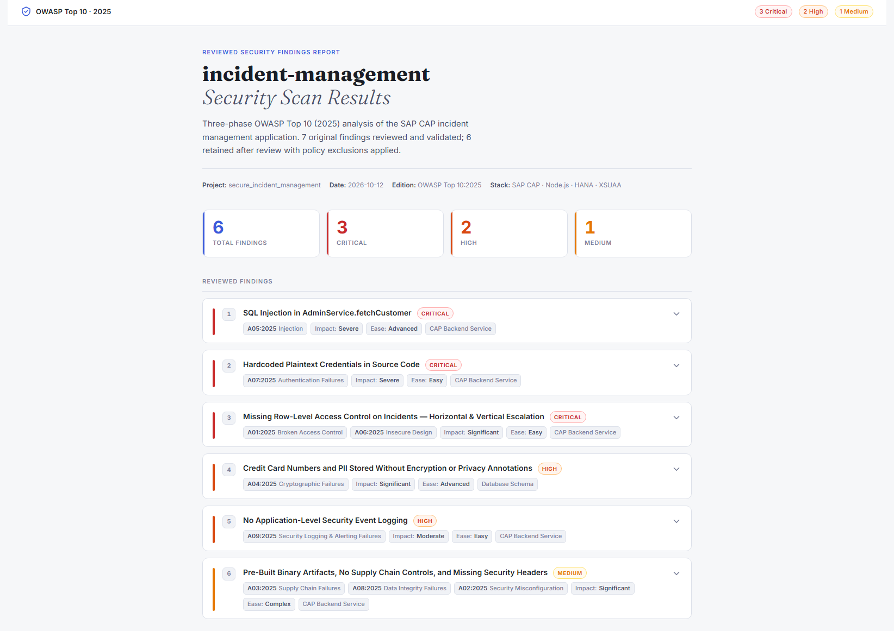
  <br>
  <b></b>
</p>

> **Note:**  Open 2026-10-21_secure_incident_management_REPORT.html in your browser by right-clicking the file in the BAS Explorer and selecting Download.
The full report contains detailed evidence for each finding, including exact file paths, line numbers, code snippets, attack preconditions, and remediation recommendations. Take a few minutes to read through it before continuing 
— understanding the evidence now will make the hands-on exercises much clearer.

### Step 3 — Identify the Exercise Targets

Three of the 8 findings map directly to the hands-on exercises you will complete next. These are the vulnerabilities you will learn to exploit and remediate:

| Finding | Severity | OWASP Category | Your Exercise |
|---------|----------|---------------|---------------|
| #1 — SQL Injection in `AdminService.fetchCustomer` | 🔴 Critical | **A05 Injection** | [Exercise 2](../ex2/README.md) |
| #2 — Missing row-level access control on Incidents | 🔴 Critical | **A01 Broken Access Control** | [Exercise 1](../ex1/README.md) |
| #5 — No security audit logging| 🟡 Medium | **A09 Logging & Alerting Failures** | [Exercise 3](../ex3/README.md) |


The remaining 5 findings are real vulnerabilities documented in the report. They are not covered in the hands-on exercises but represent common security gaps in cloud applications that should be addressed in a production environment.

> **Note:** A live scan takes 10-20 minutes and consumes AI Core credits. The pre-generated results are sufficient for all exercises.


## Summary

Now that you have made yourself familiar with the setup,
continue to - [Exercise 1 - Broken Access Control](../ex1/README.md)
