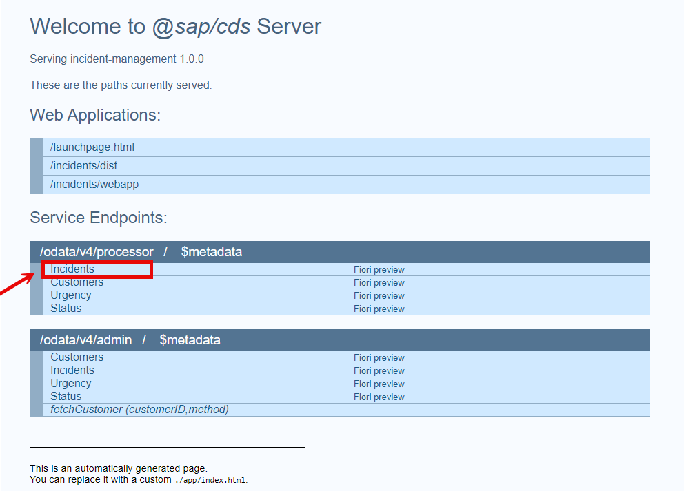

# Exercise 3.1 - Audit Logging for Sensitive Data Access in Local Development
Vulnerability: [A09:2025-Security Logging & Alerting Failures](https://top10.owasp.org/2025/A09_2025-Security_Logging_and_Alerting_Failures/)

## Table of Contents
- [📖  1. Overview](./README.md#--1-overview)
- [🚨 2. Vulnerable Code](./README.md#-2-vulnerable-code)
- [💥 3. Exploitation](./README.md#-3-exploitation)
- [🛡️ 4. Remediation](./README.md#%EF%B8%8F-4-remediation)
- [✅ 5. Verification](./README.md#-5-verification)
- [📌 6. Summary](./README.md#-6-summary)

## 📖  1. Overview

This exercise highlights how the absence of audit logging for sensitive data access creates blind spots in enterprise applications. In the Incident Management system, customer records include highly sensitive fields such as credit card numbers. As a result, users can access or exfiltrate regulated data without detection.

### 📐Business Rules

* Support Users:
  - ✅ Can view customer data.
  - ✅ Can view, create, update, and delete incidents (with restrictions on closed/high-urgency incidents).
  - ❌ Cannot access customers' sensitive data (e.g., credit card numbers).
  - ⚠️ All access attempts must be logged (e.g., who accessed/modified which incident and when).

* Administrators:
  - ✅ Full access to customer and incident data.
  - ⚠️ All operations, including access to sensitive fields, are logged for audit compliance.

### 🎯 Key Learning Objectives

* Ensure users only access customer data they are authorized to view.
* Implement object-level authorization, data masking, and audit logging.
* Maintain comprehensive records of access.

## 🚨 2. Vulnerable Code
We’ll build upon [Exercise 2 - SQL Injection](../../ex2/README.md#%EF%B8%8F-4-remediation) by integrating audit logging - a critical missing piece in the original implementation - to track security-sensitive actions.

⚠️ Note: Do not copy the code from the **Vulnerable Code** section into your project.

**File**: `db/schema.cds`
```
entity Customers : managed { 
  key ID        : String;
  firstName     : String;
  lastName      : String;
  name          : String = firstName ||' '|| lastName;
  email         : EMailAddress;
  phone         : PhoneNumber;
  incidents     : Association to many Incidents on incidents.customer = $self;
  creditCardNo  : String(16) @assert.format: '^[1-9]\d{15}$';  // ❌ No access control or data masking
  addresses     : Composition of many Addresses on addresses.customer = $self;
}

```

**File**: `srv/services.cds`
```
using { sap.capire.incidents as my } from '../db/schema';

service ProcessorService {
  @restrict: [
    { grant: ['READ', 'CREATE'], to: 'support' },  // Support can view and create
    { grant: ['UPDATE', 'DELETE'], 
      to: 'support',
      where: 'assignedTo is null or assignedTo = $user'  // Horizontal control for support
    },
    { grant: '*', to: 'admin' }  // Admin full access
  ]
  entity Incidents as projection on my.Incidents;
  
  @readonly
  entity Customers as projection on my.Customers;  // ❌ Exposes all customers data to support users.
}

... Other methods

```

**Why This is Vulnerable:**

- ❌ **No object-level validation:** A support user can manipulate customer IDs in the API to access other customer's data, including credit card numbers.
- ❌ **No data classification:** Credit card numbers are not annotated as sensitive, so audit logging isn't triggered.
- ❌ **No data masking:** Credit card numbers are displayed in plain text to all users.
- ❌ **No audit trail:**  No logging of access attempts to customer & incident data, making security monitoring impossible.
- ❌ **No audit logging:** No record of who accessed which customer data, when, or what they did.
- ❌ **Compliance gap:** Lacks detailed audit records required by regulations like GDPR, SOX, and other industry standards.

## 💥 3. Exploitation
In this workshop, a **Security Logging and Monitoring Failures** vulnerability is exploited via API calls in a local development environment **(SAP Business Application Studio with cds watch)**. Unlike production, key security measures such as real authentication flows, OAuth2 tokens, and data isolation are inactive, allowing ethical hackers to safely simulate attacks, validate vulnerabilities without risking live systems, and rapidly iterate fixes before deploying to production.

### 🪜 Step 1: Start Local Development Server

- ▶️ Action : Open a Terminal under  **secure_incident_management** folder and run the following command (within SAP Business Application Studio or your local environment):
  
```
 cds watch 

```
- ✅ Results :

```
[cds] - connect using bindings from: { registry: '~/.cds-services.json' }
[cds] - connect to db > sqlite { url: ':memory:' }
  > init from db/data/sap.capire.incidents-Urgency.texts.csv 
  > init from db/data/sap.capire.incidents-Urgency.csv 
  > init from db/data/sap.capire.incidents-Status.texts.csv 
  > init from db/data/sap.capire.incidents-Status.csv 
  > init from db/data/sap.capire.incidents-Incidents.csv 
  > init from db/data/sap.capire.incidents-Incidents.conversation.csv 
  > init from db/data/sap.capire.incidents-Customers.csv 
  > init from db/data/sap.capire.incidents-Addresses.csv 
/> successfully deployed to in-memory database. 

[cds] - using auth strategy {
  kind: 'mocked',
  impl: 'node_modules/@sap/cds/lib/srv/middlewares/auth/basic-auth'
} 

[cds] - serving ProcessorService { impl: 'srv/services.js', path: '/odata/v4/processor' }
[cds] - serving AdminService { impl: 'srv/services.js', path: '/odata/v4/admin' }

[cds] - server listening on { url: 'http://localhost:4004' }
[cds] - server launched in: 673.811ms
```

### 🪜 Step 2: List All Customers
- ▶️ Action: 
  - Click on the link to **localhost:4004** in the terminal window to connect to your locally running CAP server.
  - Click on Customers under the Service Endpoints: **/odata/v4/processor/$metadata** section.

  <p align="center">
    
    <br>
    <b></b>
  </p>

  - Use the following credentials if required : **Username = 'alice'**,  **Password: [leave empty — no password required]**
- Result:
  - Note: You might want to enable the checkbox **"Pretty-print"** for better readability.
```
{
  "@odata.context": "$metadata#Customers",
  "value": [
    {
      "createdAt": "2025-08-27T09:06:00.013Z",
      "createdBy": "anonymous",
      "modifiedAt": "2025-08-27T09:06:00.013Z",
      "modifiedBy": "anonymous",
      "ID": "1004100",
      "firstName": "Sunny",
      "lastName": "Sunshine",
      "name": "Sunny Sunshine",
      "email": "sunny.sunshine@demo.com",
      "phone": "+49-555-789",
      "creditCardNo": "3400000000000094"
    },
... Other customers' records.
  ]
}
```
- ❌ No audit record is produced in local log files or the console output of the CAP runtime for any audit entries.
- ❌ Sensitive data (e.g., credit card numbers) is not masked or protected in output.

## 🛡️ 4. Remediation
To address the identified vulnerabilities and data privacy risks, this section implements CAP's built-in security controls through:
  1. **Personal Data Annotation** - Explicitly tags sensitive fields for GDPR compliance.
  2. **Automated Audit Logging** - Tracks all access to protected data with `@cap-js/audit-logging`.
  3. **Fine-Grained Access Control** - Limits customer data visibility by user role.

### 🪜 Step 1: Add Audit Logging Dependency

- ▶️ Action : Terminate the cds watch command (ctrl + C). Then add the `@cap-js/audit-logging` plugin to your project secure_incident_management.

```
npm install @cap-js/audit-logging
```  
- ✅ Result:
  -  **Updates package.json** – The `@cap-js/audit-logging` dependency is automatically added to your project’s [package.json](./package.json) file.
  - **Enables Automatic Audit Logging** – For every entity or field annotated with `@PersonalData`, all access and modifications are captured in real time.
  - **Tracks CRUD Operations** – Create, Read, Update, Delete on annotated data are fully traced.
  - **Generates GDPR-Compliant Audit Trails** – Logs are formatted to meet regulatory requirements, simplifying compliance reporting.

### 🪜 Step 2: Annotate Personal Data

- ▶️ Action : 
  - Create a new file /srv/data-privacy.cds in the project
  - Copy the contents of [data-privacy.cds](./srv/data-privacy.cds) into the /srv/data-privacy.cds file.
  - Open 'data-privacy.cds' from your project and make sure the annotations for Customers and Addresses are present - exactly as shown here. 

```
using { sap.capire.incidents as my } from './services';

// Annotating the my.Customers entity with @PersonalData to enable data privacy
annotate my.Customers with @PersonalData : {
  EntitySemantics : 'DataSubject',
  DataSubjectRole : 'Customer'
} {
  ID            @PersonalData.FieldSemantics : 'DataSubjectID';     // Identifier for the data subject, can also be used to generate audit logs
  firstName     @PersonalData.IsPotentiallyPersonal;                // Personal data that can potentially identify a person (firstName,lastname,email,phone)
  lastName      @PersonalData.IsPotentiallyPersonal;
  email         @PersonalData.IsPotentiallyPersonal;
  phone         @PersonalData.IsPotentiallyPersonal;
  creditCardNo  @PersonalData.IsPotentiallySensitive;               // Sensitive personal data requiring special treatment and access restrictions
}

// Annotating the my.Addresses entity with @PersonalData to enable data privacy
annotate my.Addresses with @PersonalData : {
  EntitySemantics : 'DataSubjectDetails'
} {
  customer      @PersonalData.FieldSemantics : 'DataSubjectID';
  city          @PersonalData.IsPotentiallyPersonal;
  postCode      @PersonalData.IsPotentiallyPersonal;
  streetAddress @PersonalData.IsPotentiallyPersonal;
}
```
- ✅ Result:
  - Sensitive fields like creditCardNo are marked as sensitive personal data.
  - Audit logs automatically include these fields in tracking, ensuring data privacy and regulatory adherence.

### 🪜 Step 3: Create server.js with Custom 403 Handler

As part of audit logs, there can be cases where you want to generate custom audit logs. For example, if you want to log 403 - Forbidden events when a user is not having roles but is still trying to access certain data. This can be achieved by adding custom handlers in a CAP application.

- ▶️ Action:
  - Create a new file '/srv/server.js' in your project.
  - Copy the contents of [server.js](./srv/server.js) into the '/secure_incident_management/srv/server.js' file.
  - Open 'server.js' from your project and make sure that the 403-audit logic (non-batch + batch sub-requests) are present exactly as shown here:

```
const cds = require('@sap/cds')
const LOG = cds.log('security')   // structured logger for audit-pipeline failures

let audit

cds.on('served', async () => {
  audit = await cds.connect.to('audit-log')
})

const audit_log_403 = (resource, ip) => {
  // Guard: audit may not be initialized on the very first request
  if (!audit) {
    LOG.warn('audit-log service not ready; SecurityEvent not persisted for', resource)
    return
  }
  // own tx because the default tx may be burnt
  audit.tx(async () => {
    await audit.log('SecurityEvent', {
      data: {
        user: cds.context?.user?.id || 'unknown',
        action: `Attempt to access restricted resource "${resource}" with insufficient authority`
      },
      ip
    })
  }).catch(err => LOG.error('FAILED to persist SecurityEvent audit log', err))
}

// log for non-batch requests
cds.on('bootstrap', app => {
  app.use((req, res, next) => {
    req.on('close', () => {
      if (res.statusCode == 403) {
        const { originalUrl, ip } = req
        audit_log_403(originalUrl, ip)
      }
    })
    next()
  })
})

// log for batch subrequests — null-safe, isolated (cannot crash the process)
cds.on('serving', srv => {
  if (srv instanceof cds.ApplicationService) {
    srv.on('error', (err, req) => {
      try {
        const status = Number(err?.status || err?.code)
        if (status !== 403) return
        const http = req?.http?.req
        const originalUrl = http?.originalUrl || ''     
        if (originalUrl.endsWith('/$batch')) {
          audit_log_403(originalUrl, http?.ip)          // ✅ use originalUrl as-is
        }
      } catch (e) {
        // never let the audit path break error handling (would crash the app)
        LOG.error('audit error-handler failed', e.message)
      }
    })
  }
})

module.exports = cds.server
```

- ✅ Result:

  - Three event handlers are implemented to enable comprehensive audit logging for security incidents like 403 Forbidden responses:
      - `cds.on('served')`: Establishes connections to services like 'audit-log' after initialization, preparing resources for global event processing.
      - `cds.on('bootstrap')`: Monitors HTTP response status codes for non-batch requests and triggers audit logging when a 403 error occurs.
      - `cds.on('serving')`: Captures 403 errors within OData batch operations and logs them appropriately for service-specific events.
   
  - Structured, level-controlled, production-ready output — cds.log('security') emits source-tagged entries ([security]) with proper log levels (warn/error) that integrate with SAP BTP Application Logging / Cloud Logging, unlike console.* which is unstructured stdout with no level, correlation, or retention control.
  - The `audit_log_403` function is configured to capture **SecurityEvent** logs for all 403 Forbidden responses.
  

## ✅ 5. Verification

This section evaluates the implementation of audit logging and data protection in the CAP application.

- Key aspects include:
  - Ensuring sensitive fields (e.g., creditCardNo) are properly annotated for logging.
  - Confirming role-based access controls are enforced.
  - Verifying that audit logs record all API interactions, such as `SensitiveDataRead`, `PersonalDataModified`, and `SecurityEvent`.

- Testing is performed both locally in SAP Business Application Studio and in SAP BTP production environments to validate that logs are correctly generated, masked, and compliant with enterprise security standards.

### Local Environment Setup

#### 🪜 Step 1:  Generate HTTP Test Files

- ▶️ Action:
  - To create HTTP request templates for testing your services, run the following commands in your terminal from the project root:
  ```
    cds add http --filter ProcessorService
    cds add http --filter AdminService
  ```

- ✅ Results:
  - The AdminService.http and ProcessorService.http  files are generated under the test folder with sample GET, POST, and PATCH requests for testing.
  - These files include pre-configured authentication headers and request bodies for different user roles.
  - Ready to use with SAP Business Application Studio's REST Client extension.


#### 🪜 Step 2: Set Up Local Server
- ▶️ Action:

   - Start the CDS server in watch mode from SAP Business Application Studio command line under **secure_incident_management** folder:
    ```
    cds watch
    ```

 - ✅ Results:
    - The server is running, and the Rest Extension is ready for testing.
    - Audit logs are enabled and accessible via the terminal.   

 
#### 🪜 Step 3: Test Read Access to Customer Data with Support User
- ▶️ Action:
  - Open the test/http/ProcessorService.http file.
  - Ensure that the username is 'alice'. The password should be left empty.
  - Scroll to line 111 and click on 'Send Request' to run the 'GET {{server}}/odata/v4/processor/Customers' request.

- ✅ Results:
  - Here is a sample audit log event **SensitiveDataRead** for one customer entity. In your log, the timestamp matches the current timestamp.
    ```
    [odata] - GET /odata/v4/processor/Customers 
    [cds] - connect to audit-log > audit-log-to-console 
    [audit-log] - SensitiveDataRead: {  // SensitiveDataRead event generated
      data_subject: {
        id: { ID: '1004155' },
        role: 'Customer',
        type: 'ProcessorService.Customers'
      },
      object: { type: 'ProcessorService.Customers', id: { ID: '1004155' } },
      attributes: [ { name: 'creditCardNo' } ],
      uuid: '0bf74230-e246-445c-915b-3220d0643302',
      tenant: undefined,
      user: 'alice',
      time: 2025-08-29T08:17:51.865Z
    }
    ... other customer's entities
    ```
    
  - Each customer entity generates a separate audit log entry.
  - When creditCardNo is accessed, a **SensitiveDataRead** log is automatically generated.
  - These events are richer than standard audit logs and include:
    - Who accessed the data
    - When it was accessed
    - Context of the access

#### 🪜 Step 4: Test Write Access to Customer Data with Admin User
- ▶️ Action:
  - Open the file test/http/AdminService.http.
  - Change the username to 'incident.support@tester.sap.com' (admin role), password : 'initial'.
  - Scroll to line 24 and replace the value of the "creditCardNo" field with "1234567890123456".
  - Scroll to line 13 and and click on 'Send Request' to run the 'POST {{server}}/odata/v4/admin/Customers' request.
 
- ✅ Results: Here is a sample audit log **PersonalDataModified** for one customer entity. In your log, the timestamp matches the current timestamp.
```
[odata] - POST /odata/v4/admin/Customers 
[audit-log] - PersonalDataModified: {
  data_subject: {
    id: { ID: 'Customers-20802721' },
    role: 'Customer',
    type: 'AdminService.Customers'
  },
  object: {
    type: 'AdminService.Addresses',
    id: { ID: '19987045-c3b4-4115-8427-59808d91e7ff' }
  },
  attributes: [
    { name: 'city', new: 'city-19987045' },
    { name: 'postCode', new: 'postCode-19987045' },
    { name: 'streetAddress', new: 'streetAddress-19987045' }
  ],
  uuid: '87973499-52eb-4539-9b7e-54ded16673dd',
  tenant: undefined,
  user: 'incident.support@tester.sap.com',
  time: 2026-10-08T08:15:33.319Z
}
[audit-log] - PersonalDataModified: {
  data_subject: {
    id: { ID: 'Customers-20802721' },
    role: 'Customer',
    type: 'AdminService.Customers'
  },
  object: { type: 'AdminService.Customers', id: { ID: 'Customers-20802721' } },
  attributes: [
    { name: 'firstName', new: 'firstName-20802721' },
    { name: 'lastName', new: 'lastName-20802721' },
    { name: 'email', new: 'email-20802721' },
    { name: 'phone', new: 'phone-20802721' },
    { name: 'creditCardNo', new: '***' }
  ],
  uuid: '1e47ce02-f921-4398-96a1-7a74f0a47df7',
  tenant: undefined,
  user: 'incident.support@tester.sap.com',
  time: 2026-10-08T08:15:33.319Z
}
[audit-log] - PersonalDataModified: {
  data_subject: {
    id: { ID: 'Customers-20802721' },
    role: 'Customer',
    type: 'AdminService.Customers'
  },
  object: {
    type: 'AdminService.Addresses',
    id: { ID: '19987046-4d1d-49e1-9b04-04ab3524d8c4' }
  },
  attributes: [
    { name: 'city', new: 'city-19987046' },
    { name: 'postCode', new: 'postCode-19987046' },
    { name: 'streetAddress', new: 'streetAddress-19987046' }
  ],
  uuid: '4bd0af4f-e642-497f-9183-7acf2d5ee4b0',
  tenant: undefined,
  user: 'incident.support@tester.sap.com',
  time: 2026-10-08T08:15:33.319Z
}
[audit-log] - SensitiveDataRead: {
  data_subject: {
    id: { ID: 'Customers-20802721' },
    role: 'Customer',
    type: 'AdminService.Customers'
  },
  object: { type: 'AdminService.Customers', id: { ID: 'Customers-20802721' } },
  attributes: [ { name: 'creditCardNo' } ],
  uuid: 'f6a9787e-1e80-4c1e-97dd-f0f4b3329984',
  tenant: undefined,
  user: 'incident.support@tester.sap.com',
  time: 2026-10-08T08:15:33.319Z
}

```
  - ✅ A single POST /odata/v4/admin/Customers automatically triggers four audit log entries — no custom code required.
  - ✅ **PersonalDataModified** entries are generated for every field annotated with **@PersonalData.IsPotentiallyPersonal** (firstName, lastName, email, phone, city, postCode, streetAddress) showing the new value.
  - ✅ **PersonalDataModified** entries for fields annotated with **@PersonalData.IsPotentiallySensitive** (creditCardNo) are automatically masked as *** — the value is never exposed in the audit log.
  - ✅ An additional **SensitiveDataRead** entry is generated whenever a IsPotentiallySensitive field is read, including in POST response bodies.
  - ✅ The data_subject block links all entries to the same individual via **@PersonalData.FieldSemantics**: 'DataSubjectID' — required for [SAP Personal Data Manager integration](https://cap.cloud.sap/docs/guides/security/dpp-pdm#cap-service-model-for-sap-personal-data-manager)
  - ✅ Address fields are logged as DataSubjectDetails and linked back to the DataSubject (Customer), matching the EntitySemantics declared in data-privacy.cds.
  - ✅ This behavior is regulated by the @cap-js/audit-logging plugin and the @PersonalData annotations in data-privacy.cds. see the [documentation Reference App Sample](https://cap.cloud.sap/docs/guides/security/dpp-annotations#annotated-model).


#### 🪜 Step 5: Test Write Access to Customer Data with Support User
- ▶️ Action:
  - Open the file test/http/AdminService.http.
  - Change the username to 'alice'. The password should be empty.
  - Go to line 13 and and click on 'Send Request' to run the 'POST {{server}}/odata/v4/admin/Customers' request.

- ✅ Result: Audit logs generate **SecurityEvent** for one customer entity. In your log, the timestamp matches the current timestamp.
```
[odata] - POST /odata/v4/admin/Customers 
[odata] - 403 - [Error: User 'alice' is lacking required roles: [admin]

... stack log

{
  status: 403,
  code: '403'
}
[audit-log] - SecurityEvent: {
  data: {
    user: 'alice',
    action: 'Attempt to access restricted resource "/odata/v4/admin/Customers" with insufficient authority'
  },
  ip: '::ffff:127.0.0.1',
  uuid: '9eb6bf5f-12c2-4fbe-bf9a-f38de7e92df6',
  tenant: undefined,
  user: 'alice',
  time: 2026-10-04T13:59:51.692Z
}
```
- ✅ Audit logs generate a **SecurityEvent** entry for the unauthorized write attempt.
- ✅ No **PersonalDataModified** entry is created.


### 📌 Verification Summary 
Verification confirmed that:
  * All sensitive fields (e.g., creditCardNo) are annotated with `@PersonalData`, masked in API responses, and tracked in audit logs.
  * Role-based access controls enforce least-privilege, effectively blocking unauthorized data exposure.
  * Audit logs  capture every critical event (`SensitiveDataRead`, `PersonalDataModified`, `SecurityEvent`) with full contextual details.
  * `@PersonalData.IsPotentiallyPersonal` → Audit logs are triggered for modification events only (create, update, delete).
  * `@PersonalData.IsPotentiallySensitive` → Audit logs are triggered for both modification and read (access) events.


    
## 📌 6. Summary
In this exercise, you have learned how:
* To implement data masking and audit logging for sensitive fields (e.g., creditCardNo) using `@PersonalData` annotations and the `@cap-js/audit-logging` plugin.
* To enforce strict role-based access controls that prevent unauthorized data exposure while ensuring all administrator operations are audited.
* To generate comprehensive security event logs for unauthorized access attempts, enabling regulatory compliance with PCI-DSS and GDPR requirements.


👉 Next up: [Exercise 3.2 - Security Event Monitoring in SAP BTP Production Environment](../ex3.2/README.md), where we take these audit logs beyond local testing and validate them in a production-grade enterprise environment.
