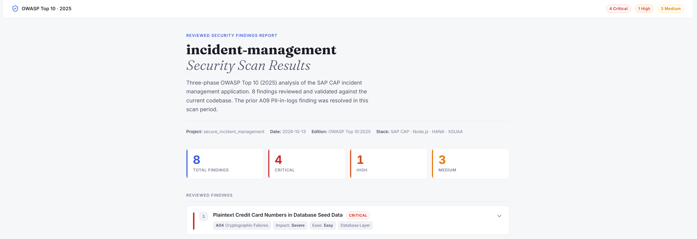

# Exercise 4 — Validate Security with the AI OWASP Scanner Assistant

## Contents

1. [📖 Overview](#-1-overview)
2. [🔍 How AI-Driven Security Scanning Works](#-2-how-ai-driven-security-scanning-works)
3. [⚙️ Environment Verification]([#-3-environment-verification](#-3-environment-verification))
4. [🔄 Post-Remediation Live Verification](#-4-post-remediation-live-verification)
5. [📌 Summary & Next Steps](#-6-summary--next-steps)

---

## 📖 1. Overview

Welcome to the final exercise. Here you move from *fixing* vulnerabilities to *proving* they are fixed — using the AI OWASP Scanner Assistant to independently validate the work you did in Exercises 1–3.

### 🎯 Key Learning Objectives

- Understand the three-phase AI scanning pipeline behind the OWASP Scanner Assistant.
- Verify that the **AI Security Assistant environment** is operational and connected end-to-end to SAP AI Core.
- Run a **live OWASP scan** to prove your Exercise 1–3 fixes (A01, A05, A09) actually closed the vulnerabilities.
- Read a security report critically — distinguishing confirmed fixes from **accepted risks** and out-of-scope findings.

| | |
| --- | --- |
| 🧩 **Application under test** | `secure_incident_management` — an SAP **CAP · Node.js · HANA · XSUAA** incident-management app. |
| ✅ **Prerequisite** | Exercises 1–3 complete: **A01** Broken Access Control, **A05** Injection, and **A09** Logging & Alerting Failures remediated. |
| ⏱️ **Time** | ~20–25 minutes (a live scan runs 10–15 minutes). |
---

## 2. How AI-Driven Security Scanning Works

This workshop uses the **AI OWASP Scanner Assistant** — a Claude Code plugin (at `owasp-scan/skills/`) that reasons about your code *with evidence*, assessing it against the [**OWASP Top 10 (2025)**](https://top10.owasp.org/2025/). You invoke it from the Claude Code prompt with a single command (an optional path defaults to the current project):

```text
/owasp-analysis [path/to/project]
```

### 🔄 The Four-Stage Pipeline

It runs a **four-stage, evidence-grounded pipeline**. Each stage writes its output into the project's `.owasp-scan/` folder before the next stage begins:

```
    /owasp-analysis
           │
           ▼
┌────────────────────┐     ┌────────────────────┐     ┌────────────────────┐     ┌────────────────────┐
│ Phase 1            │     │ Phase 2            │     │ Phase 3            │     │ Phase 4            │
│ ANALYSIS           │     │ REVIEW             │     │ POLICY EXCLUSIONS  │     │ HTML DASHBOARD     │
│ Security Expert    │ ──> │ Senior Reviewer    │ ──> │ Accepted-risk pass │ ──> │ Interactive report │
│ FINDINGS           │     │ REVIEWED + JSON    │     │ Final report       │     │ _REPORT.html       │
└────────────────────┘     └────────────────────┘     └────────────────────┘     └────────────────────┘
```

| Phase | Role | What happens |
| :---: | --- | --- |
| **1 · Analysis** | Security Expert | One thorough pass over all ten categories (A01–A10), exploring the codebase directly. **No finding without evidence** (file + line). Severity comes from the criticality matrix — never "by gut feeling." |
| **2 · Review** | Senior Reviewer | Re-verifies each finding against the code, removes false positives, and **deduplicates** overlapping issues. Emits Markdown and JSON. |
| **3 · Policy Exclusions** | Accepted-risk pass | Removes findings that match the documented accepted risks in `policy-exclusions.md` and logs them for audit, then updates the Markdown and JSON. |
| **4 · HTML Dashboard** | Report generation | Builds the interactive HTML report (`_REPORT.html`) from the **final, post-exclusion** findings — so the dashboard always matches the curated result. |

> **🔍 Validation gate:** Between Phase 1 and Phase 2, a script (`validation/validate.py`) checks every finding against a JSON schema for structure and risk-score consistency. Anything that fails is dropped — so the final report contains only evidence-backed findings.


### 🧮 How Severity Is Decided

When the scanner raises a finding, the first thing you want to know is simple: *how serious is this?* That's what we mean by **Severity**.
The scanner captures that in a single label it calls the **Criticality**, so *Severity* and *Criticality* are the same thing wearing two hats: **severity is the plain-English idea, and Criticality is the exact label the scanner puts on it.**

Every finding gets a **Criticality** — the label that answers "how serious is this?" (`Critical`, `High`, `Medium`, or `Low`). The scanner doesn't decide this by opinion. It works it out from two inputs:

- **Impact** — *how much damage* if someone exploited this? (`Minor → Moderate → Significant → Severe`)
- **Ease of Attack** — *how hard* is it to actually pull off? (`Very Complex → Complex → Advanced → Easy`)

That's why **two reviewers (or two scans) rate the same issue the same way**: once they agree on the Impact and the Ease,  the table — not a personal judgment call — produces the final severity. The result is reproducible and free of reviewer bias.

Here's the lookup table the scanner uses:

| Impact \ Ease | Very Complex | Complex | Advanced | Easy |
| --- | :---: | :---: | :---: | :---: |
| **Severe** | High | High | **Critical** | **Critical** |
| **Significant** | Medium | Medium | High | **Critical** |
| **Moderate** | Low | Medium | Medium | High |
| **Minor** | Low | Low | Medium | Medium |

> **✅ You now have the mental model.** Next, in **Section 3 — Environment Verification**, you'll confirm the assistant that runs this pipeline is live and connected to SAP AI Core.


## ⚙️ 3. Environment Verification

Before scanning, confirm the AI Security Assistant is installed and connected end-to-end. The request chain you are validating is:

Claude Code CLI  →  LiteLLM proxy (localhost:4000)  →  SAP AI Core  →  LLM (claude-sonnet-5)

You will use three terminals in SAP Business Application Studio (BAS). Open each with **Terminal → New Terminal**.

| Terminal | Purpose |
| :---: | --- |
| **Terminal 0** | Run verification commands |
| **Terminal 1** | Run the LiteLLM proxy (stays open) |
| **Terminal 2** | Run Claude Code (stays open) |


### 3.1 Check the Pre-Installed Components — Terminal 0

From the workspace root `~/projects/workshop-xp261`, run each command and confirm the expected result.

```bash
# 1. Claude Code CLI is installed
claude --version
#    Expected: a version string, e.g.  2.0.14 (Claude Code)

# 2. LiteLLM proxy is present in its virtual environment
ls litellm-proxy-ai-core/.venv/bin/litellm
#    Expected: the path prints back (the file exists)

# 3. OWASP Scanner plugin is present
ls owasp-scan/skills/SKILL.md
#    Expected: owasp-scan/skills/SKILL.md

# 4. Environment variables are configured
cat litellm-proxy-ai-core/.env
#    Expected: three exports — LITELLM_MASTER_KEY, AICORE_RESOURCE_GROUP, AICORE_SERVICE_KEY
```

### 3.2 Start the LiteLLM Proxy — Terminal 1

The proxy connects Claude Code to SAP AI Core. Start it and leave the terminal running for the whole exercise.

```bash
cd ~/projects/workshop-xp261
./start-litellm.sh
```

**Expected result** — the log ends with the Uvicorn startup banner:

```text
INFO:     Application startup complete.
INFO:     Uvicorn running on http://0.0.0.0:4000 (Press CTRL+C to quit)
```

Seeing `Uvicorn running on http://0.0.0.0:4000` means the proxy is listening on **port 4000**.

> **⚠️ Troubleshooting**
> - **`Not logged in to Cloud Foundry`** → runs `cf login -a https://api.cf.eu10-005.hana.ondemand.com --origin akihlqzx8-platform`.
> - **`Address already in use` (port 4000)** → an old proxy is still running. Run `pkill -9 -f "bin/litellm"` in Terminal 0, then start the script again.

---

### 3.3 Launch Claude Code — Terminal 2

In a third terminal, start Claude Code. It auto-detects the proxy on port 4000.

```bash
cd ~/projects/workshop-xp261
./start-claude.sh
#    Expected: "LiteLLM detected on port 4000"
```
You may see this yellow warning when Claude Code starts:

```text
> -  ⚠ Cross-session messaging is off: its socket directory could not be set up: '/tmp' is world-writable without the sticky bit…
```
For this workshop we run a single Claude Code session, so cross-session messaging is never used. The warning has no impact on the OWASP security scan.

On the **first launch only**, answer four one-time prompts:

| # | Prompt | Your answer |
| :---: | --- | --- |
| 1 | Terminal settings | Accept the recommended **`Shift+Enter`** keybinding |
| 2 | Workspace trust | Select **`Yes, I trust this folder` workshop-xp261 ** |
| 3 | Bypass permissions warning | Select **`Yes, I accept`** |

---

### 3.4 Test the Connection

At the Claude Code prompt, type a short message and press Enter:

```text
Hello
```

**Expected result:** Claude Code replies with a normal greeting. A valid reply proves the full chain works:

```text
Claude Code CLI  →  LiteLLM (port 4000)  →  SAP AI Core  →  LLM
```

> **⚠️ Troubleshooting**
> - **`LiteLLM proxy not detected`** → Terminal 1 is not running. Go back to **3.2** and start it.
> - **`Connection refused`** → the proxy is not reachable. In Terminal 0, run `curl http://127.0.0.1:4000/health/readiness` to confirm it responds.
> - **HTTP 400 (Bad Request)** → a credential issue, ask the instructor for help.

---

### Final State

| Terminal | Command | State |
| :---: | --- | --- |
| **0** | `claude --version`, `ls …`, `cat …` | Idle at the prompt |
| **1** | `./start-litellm.sh` | Running — shows `Uvicorn … 0.0.0.0:4000`. Keep open. |
| **2** | `./start-claude.sh` | Running — prompt active, replies to `Hello`. Keep open. |

> **✅ Environment ready.** All components are installed, the LiteLLM proxy is bridging to SAP AI Core, and Claude Code answers through the full chain.

## 🔄 4. Post-Remediation Live Verification

You have fixed three vulnerabilities by hand — **Broken Access Control** (Exercise 1), **SQL Injection** (Exercise 2), and **Security Logging** (Exercise 3). Now you will run the scanner **live** against your changed code and compare the result to the **Exercise 0 baseline** to prove the fixes worked.

### 5.1 Run the Live Scan

The scanner skips any phase whose output already exists, so delete the previous results first to force a full re-scan. In **Terminal 0**:

```bash
rm -rf ~/projects/workshop-xp261/secure_incident_management/.owasp-scan/
```

In **Terminal 2** (Claude Code), start the scan and confirm the target when prompted:

```text
/owasp-analysis
```

> **⚠️ Note:** A live scan takes **10–15 minutes** and uses SAP AI Core credits. Watch the three phases run in order (Analysis → Review → Policy Exclusions) and wait for the **"OWASP Security Scan Complete"** message before opening the report.

### 5.2 Open the Report

When the scan finishes, download and open the regenerated interactive report secure_incident_management/.owasp-scan/2026-10-13_secure_incident_management_REPORT.html.


The dashboard header summarizes the new result:

  <p align="center">
    
    <br>
    <b></b>
  </p>


A sample of the report you should expect is attached below.

### 5.3 Validate Your Fixes — Baseline (Ex0) vs. Live Scan

The three vulnerabilities you targeted in Exercises 1–3 **no longer appear** in the live scan:

| Exercise 0 Baseline Finding | OWASP | Your Exercise | Status in Live Scan |
| --- | :---: | :---: | --- |
| Missing row-level access control on Incidents | A01 | Exercise 1 | ✅ **Resolved — not detected** |
| SQL Injection in `AdminService.fetchCustomer` | A05 | Exercise 2 | ✅ **Resolved — not detected** |
| No application-level security event logging | A09 | Exercise 3 | ✅ **Resolved — not detected** |

> **✅ Validation result:** The scanner independently re-checked the code and found **no evidence** of the A01, A05, or A09 issues. The report explicitly notes that *"the prior A09 … finding was resolved in this scan period."* Your three fixes are confirmed.

### 5.4 Read the Numbers Carefully

| Metric | Exercise 0 Baseline | Post-Remediation Live Scan |
| --- | :---: | :---: |
| **Total findings** | 6 | 8 |
| 🔴 **Critical** | 3 | 4 |
| 🟠 **High** | 2 | 1 |
| 🟡 **Medium** | 1 | 3 |
| **Targeted vulns (A01 / A05 / A09)** | 3 present | **0 remaining** ✅ |

> **📌 There is an improvement, but some issues remain.** Your three targeted vulnerabilities are gone, but the overall Critical count did **not** drop to zero. Two things explain this:
> 1. **Findings you did not fix remain** — they were never part of the hands-on labs (hardcoded credentials, plaintext credit-card data, missing headers, no rate limiting, supply-chain gaps).
> 2. **The deeper re-scan is more precise** — it re-rated the plaintext credit-card finding (A04) up to *Critical* (PCI-DSS), promoted *Missing HTTP Security Headers* (A02) and *No Rate Limiting* (A06) to *Critical*, and split the old combined supply-chain item into separate A03 findings. These are more detailed findings, not new vulnerabilities you introduced.

### 5.5 Findings That Remain (Out of Scope for the Labs)

| # | Severity | Finding | OWASP | Production Fix |
| :---: | :---: | --- | :---: | --- |
| 1 | 🔴 Critical | Plaintext credit-card numbers in database seed data | A04 | Encrypt/mask PANs; stop seeding real-format card numbers |
| 2 | 🔴 Critical | Missing HTTP security headers on Express server | A02 | Add Helmet middleware |
| 3 | 🔴 Critical | Hardcoded development credentials with known admin password | A07 | Move secrets out of `package.json`; enforce XSUAA |
| 4 | 🟡 Medium | External UI5 scripts loaded without Subresource Integrity | A08 | Pin CDN scripts with SRI hashes |
| 5 | 🔴 Critical | No rate limiting on any service endpoint | A06 | Add throttling / brute-force protection |
| 6 | 🟡 Medium | Binary build artifact not excluded by `.gitignore` | A03 | Remove `.mtar`; add it to `.gitignore` |
| 7 | 🟠 High | No Software Composition Analysis (SCA) tooling configured | A03 | Add dependency/SCA scanning to CI |
| 8 | 🟡 Medium | Vestigial `method` parameter in `fetchCustomer` widens attack surface | A06 | Remove the unused parameter left over from the SQL-injection fix |

> **💡 Takeaway:** A clean result on your targeted categories does **not** mean the app is fully secure — it means the *specific* risks you set out to fix are gone. These eight findings are your production backlog.

---

## 📌 5. Summary & Next Steps

### What You Accomplished

- Ran a **live OWASP Top 10 (2025) scan** against your own remediated code.
- **Validated that the three targeted vulnerabilities are eliminated:** A01 Broken Access Control, A05 Injection, and A09 Logging & Alerting Failures.
- Learned to **read a report critically** — telling confirmed fixes apart from accepted risks and out-of-scope findings, and understanding why a deeper re-scan can re-rate or surface additional issues.

### Why the AI Security Assistant Helped

| Benefit | What it meant in this exercise |
| --- | --- |
| ⚡ **Instant feedback loop** | You validated real code fixes in minutes, in the same workspace — no waiting for an external audit cycle. |
| 🧠 **Context-aware analysis** | The scanner understands SAP CAP / CDS / BTP semantics (`@restrict`, projections, `@PersonalData`, XSUAA), so it recognised your fixed access-control model instead of raising false alarms. |
| 📝 **Remediation guidance** | Every finding ships with code-level evidence (file + line), an attack precondition, and a concrete fix — the report is a work plan, not just a verdict. |
| 🔍 **Evidence-grounded & auditable** | The three-phase pipeline plus the validation gate means no finding exists without proof, and every accepted risk is logged. |

### The Bigger Picture — Security in the SSDLC (Secure Software Development Lifecycle)

You now have a repeatable inner-loop pattern for secure development on SAP BTP:

```text
write  →  scan (/owasp-analysis)  →  remediate  →  re-scan  →  validate
```

This shifts security **left** — from a late, external gate to a fast, context-aware step the developer runs alongside coding.

### Next Steps

- Address the **remaining findings** from Section 5.5 before any production deployment, starting with the Critical items (A04 plaintext PANs, A02 headers, A07 credentials, A06 rate limiting).
- Add `/owasp-analysis` to your team's definition of done, and wire SCA/dependency scanning into CI.
- Continue to the workshop wrap-up and **Additional Resources** to go deeper on SAP BTP security services.

> **🎉 Congratulations — you have completed Exercise 4 and the XP261 workshop.** You can now build, scan, remediate, and continuously validate secure SAP CAP applications on BTP.
